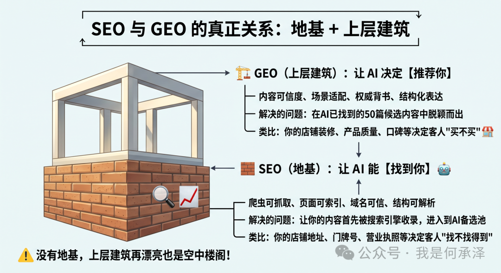
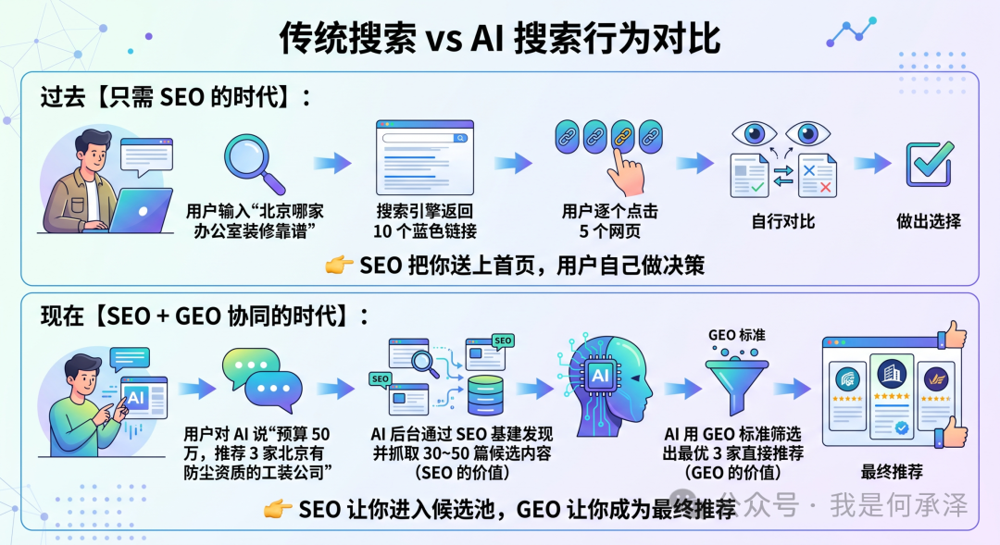
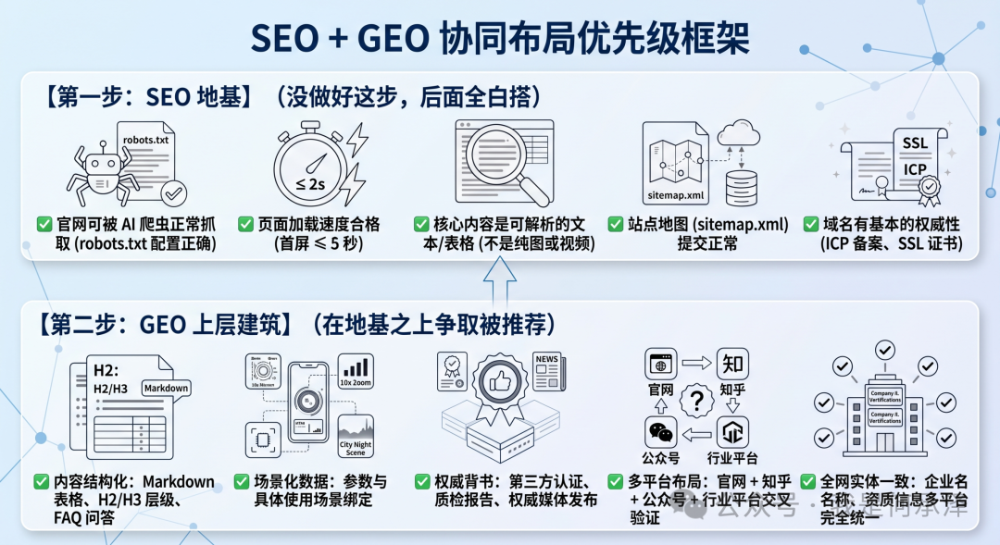

# SEO与GEO不是取代关系，而是“基建”与“决胜”

> 本文是《企业GEO实战指南：如何让 AI 优先推荐你的品牌与产品》系列第 1 篇。
> 作者：何承泽 · 首发：2026-11-01 · 原文：[微信公众号](https://mp.weixin.qq.com/s?__biz=MjM5NzU2MDI0Mg==&mid=2451311487&idx=1&sn=c6651f9a5aa7786757fb933194b6f86f)

⏱️ 3 分钟速读版>

> 1. 纠正一个认知误区：GEO 不是 SEO 的替代品。SEO 让 AI 能找到你，GEO 让 AI 决定推荐你。没有 SEO 作为前提，GEO 毫无用处。

> 2. 两者是地基与上层建筑的关系：SEO 是被发现的基础设施（爬虫抓取、搜索收录），GEO 是被优先推荐的竞争力（信任度、场景匹配、结构化表达）。

> 3. AI 搜索改变了流量的"最后一公里"：用户从"在 10 个链接里做选择题"变成"让 AI 直接给最优答案"。

大家好，我是何承泽。欢迎来到《企业 GEO 实战指南：如何让 AI 优先推荐你的品牌与产品》系列教程的第一讲。写这套教程，就是想用人人都能听懂的大白话，带你搞懂什么是 GEO、它能带来什么商业结果，以及中小企业如何低成本把 GEO 落地。作为开篇，我们先从纠正一个全网普遍存在的错误认知开始。

## 一、 纠正一个危险的认知："GEO 取代 SEO"

打开任何一个自媒体平台，搜索"GEO"，你大概率会看到这样的标题：

> "SEO 已死！GEO 才是未来！"
>
> "别再做 SEO 了，赶紧转 GEO！"
>
> "从 SEO 到 GEO：一场不可逆的大洗牌"

这些说法，从根本上就是错误的。

为什么？因为他们偷偷的混淆SEO和GEO各自解决的问题。让我用一个简单的比喻讲清楚：

说白了：

- SEO解决的是"被发现"的问题。通过SEO，让你发布的内容能把网络爬虫获取，并被搜索引擎正确收录，让你企业的内容对搜索引擎和AI系统来说是"存在的"。

- GEO解决的是"被推荐"的问题。在AI已经找到你的前提下，通过合理的内容编排、权威背书、结构化表达等方法，让 AI 在最终生成答案时优先选择引用你发布的内容。

> ⚡ 关键认知：如果你的官网或者发布的内容连爬虫都不去抓取（例如关闭web网站，做了个App），那你后续做再多的GEO内容优化都是白费。AI根本看不到你，何谈推荐你？

所以正确的策略不是"从 SEO 转向 GEO"，而是"SEO 打地基 + GEO 建上层"，两者协同发力。

## 二、 AI 搜索改变了什么？——"最后一公里"的革命

纠正了认知误区之后，我们再来看 AI 搜索到底改变了什么。

在传统搜索时代，只要通过SEO，将信息做到搜索页面的首页，用户会自己点进来看，你就有机会获得流量转化。在这个流程中，用户做筛选和裁判。

在AI搜索时代，AI 代替用户做了筛选和决策。AI 会从全网找到 30~50 篇候选内容（靠 SEO），然后根据用户的提问，从候选内容中选择合适的答案推荐给用户（靠 GEO）。在这个流程中，AI 在做筛选和裁判。

> 核心变化：过去你只需要"被找到"（SEO），用户会自己来挑你；现在你不仅要"被找到"（SEO），还要"被选中"（GEO），因为 AI 帮用户做了筛选。

所以，GEO 不是取代 SEO，而是在 SEO 基础上增加了一个新的竞争维度。

## 三、 SEO 与 GEO 各自的优化重点

理解了两者的协同关系之后，我们来看它们各自聚焦的优化重点有何不同：

| 维度 | SEO（让 AI 找到你） | GEO（让 AI 推荐你） |
| --- | --- | --- |
| 核心目标 | 确保内容可被网络爬虫发现、抓取、索引 | 确保内容在候选池中被优先引用和推荐 |
| 关键动作 | robots.txt配置、站点地图、页面加载速度、域名权重、外链建设，关键词铺设 | 内容可信度、场景化数据、权威背书、内容结构化编排、FAQ 问答 |
| 排序依据 | 关键词相关性、外链质量、技术健康度 | 内容信任度、场景匹配度、多源交叉验证 |
| 内容形态 | 标准HTML页面，迎合爬虫规则 | 在HTML页面的基础上，结构化高密度信息，迎合AI的语义理解与事实提取 |
| 用户交互 | 短关键词搜索（如"耳机 推荐"） | 口语化长 Prompt（如"500 元降噪好戴眼镜不夹头的耳机"） |
| 作弊成本 | 部分黑帽手段仍有短期效果（刷快排、泛目录） | 投机行为风险极高，AI 交叉验证信息真伪，虚假内容易被识别降权 |
| 如果不做 | AI 根本找不到你的内容 → 不存在 | AI 找到你但不推荐你 → 存在但没有竞争力 |

> ⚡ 经验观察：在实际运营中，很多企业花了大量资源做"GEO优化"，写了很好的结构化文章、做了权威背书等，但AI搜索就是不推荐。排查后发现根源是SEO的问题，最突出是将内容发布到了错误的渠道，例如企业将内容发布到权威媒体的APP上，但APP的内容很难被搜索引擎爬取收录。
>
> GEO 做得再好，如果 SEO 地基塌了，AI 看不见你，一切白搭。

## 四、 为什么现在是 SEO + GEO 协同布局的好时机？

我有一个做装修行业的朋友说："现在AI很厉害，但是现在还是自媒体，短视频比较重要。你说的GEO，等过两年再看行不行？"

基于对AI发展的趋势，我对他的建议是现在就开始，原因有三：

### 1. 用户行为的转移速度可能超出预期

2026 年3月，中国AI原生App整体月活超过‌4.4亿，其中明确标注为"AI搜索/生成式引擎”的DAU（日活跃数量）在‌3.2亿左右。这个数据意味着AI搜索的结果已经实实在在影响了中国人的日常行为。所以对于企业和品牌来说，不仅需要在传统搜索里有排名（SEO），还需要在 AI 的推荐答案里有位置（GEO）。

### 2. 当前处于 AI 搜索的早期红利阶段

回顾互联网历史，每一次新平台兴起都有早期红利：

- 2012 年公众号初期，发什么都容易获得关注；后来演变为成熟的商业化投放。

- 2018 年抖音电商初期，随手发视频就有销量；后来进入精细化投流阶段。

今天的 AI 搜索，正处于类似的早期阶段。

各大 AI 巨头为了争夺用户，正在积极优化AI搜索的结果，尚未全面开启付费竞价排名。如果你现在做好 SEO 基建，并优化 GEO 内容，可能会获得这波AI搜索的红利，获客成本远低于未来。

### 3. 早期内容积累有先发优势

AI 大模型的训练和版本更新有周期性。如果你的品牌和产品在早期就被大量AI索引并沉淀进了大模型的训练数据中，AI 可能会形成一定的"先验认知"。后来的竞争者想要替换你的位置，需要付出更多的内容建设成本。

## 五、 正确的行动框架：先 SEO 后 GEO，两手都要硬

基于以上分析，我总结了一个清晰的行动优先级框架：

> 一句话：SEO 保证你"在牌桌上"，GEO 帮你"赢牌局"。两手都要硬，但必须先有牌桌。

## 六、 课后自查

【课后自查实操】

1. SEO 自查：

用浏览器打开你的企业官网，按 Ctrl+U 查看源代码。页面是否有大量可读的文字内容？还是基本全是图片和 JavaScript？如果是后者，你的 SEO 地基可能存在严重问题。

2. GEO 自查：

打开你手机里的 DeepSeek、豆包、腾讯元宝 任意一个 AI 工具，输入你们行业客户最常问的一句话（例如："常州有哪些靠谱的自动化包装机厂家？"）。看看 AI 给出的推荐里有没有你的公司？如果没有，想想是"AI 找不到你"（SEO 问题）还是"找到了但没选你"（GEO 问题）。

把搜索结果截屏保存下来，带着你的判断，我们进入下一讲！

> 在下一讲中，我将为你剖析 AI 搜索的完整工作流程——从"用户提问"到"AI 给出推荐"的全链路拆解。我们下期见！

---

← [返回目录](../README.md)
