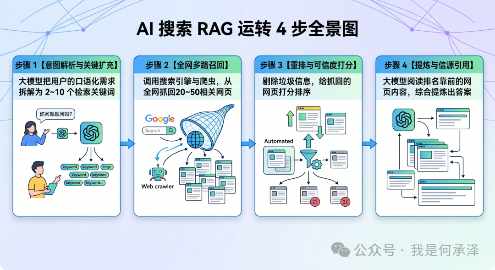
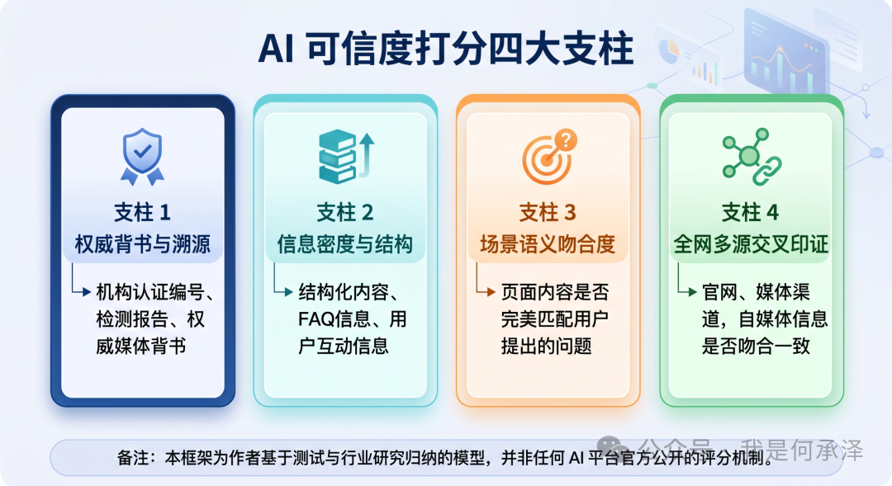

# AI 是怎么推荐你的？一文说明白AI 搜索的评分机制

> 本文是《企业GEO实战指南：如何让 AI 优先推荐你的品牌与产品》系列第 2 篇。
> 作者：何承泽 · 首发：2026-11-03 · 原文：[微信公众号](https://mp.weixin.qq.com/s?__biz=MjM5NzU2MDI0Mg==&mid=2451311497&idx=1&sn=9b84d8147e8ba2cfc903c0906b3e4fb8)

> ⏱️ 3 分钟速读版
>
> 1. AI 搜索基于 RAG（检索增强生成）架构，包括意图解析（理解用户提出的问题）、多路召回（网上查找相关资料）、重排打分（对找到的资料进行打分排序）和提炼生成（根据排名靠前的资料内容把答案写出来）四个步骤。
>
> 2. 决定内容能否被推荐的关键是可信度评分（Trust Score）。
>
> 3. 提升信任分有四大支柱：权威实体背书、信息结构化（如 Markdown/表格）、场景语义吻合、全网多源交叉印证。
>
> 4. 传统 SEO 的堆砌关键词、隐藏文本等作弊手法在 AI 搜索中是高风险行为，容易导致内容被降权或丢弃。

大家好，我是何承泽。欢迎来到《企业 GEO 实战指南：如何让 AI 优先推荐你的品牌与产品》系列教程的第二讲。写这套教程，就是想用人人都能听懂的大白话，带你搞懂什么是 GEO、它能带来什么商业结果，以及中小企业如何低成本把 GEO 落地。

> 在第一讲里，我们明确了一个核心认知：未来的商业竞争，不光要做好SEO，获得好的搜索排名，还要做好GEO，让内容进入到AI给用户的最终推荐答案里。

但很多企业管理者和运营人员还有一些困惑，例如，大模型不是经常有‘幻觉’（胡说八道）吗？当用户在 DeepSeek 或豆包里提问时，AI到底是通过什么规则决定推荐A公司而不是B公司的？这背后有规律可循，还是纯凭运气？

请相信我，AI 搜索绝不是随机抽奖，更不是玄学。

大模型在处理搜索问答时，背后有一套严密、理性的规则。第二讲，我将用尽可能用大白话，为你拆解 AI搜索的底层流水线，让你看清 AI 是如何给你的网页打分并决定是否推荐你的。

## 一、 揭秘核心架构：AI 搜索的 4 步流水线

当一个真实用户在 AI 搜索框里敲下一句话，比如：“我是做五金加工的，想买一台 3 万元以内的激光打标机，推荐两家售后好的厂家”。

在10~15秒的时间里，AI 搜素实际上经历了以下 4个复杂的处理阶段：

### 第一步：意图解析与关键词扩充

普通用户的提问往往是模糊、口语化的。大模型的第一件事，是把这句话翻译成计算机最容易检索的关键词：

- 用户输入：“3万以内激光打标机哪家售后好？”

- AI 在后台瞬间裂变为多个精准搜索词组：

- 激光打标机 价格区间 20000-30000元

- 光纤打标机 厂家 质保条款 售后评价

- 工业激光打标设备 品牌 横向对比

> 【提示】：做 GEO 优化，不要去猜单个词，而要覆盖一整套“行业场景话术”。

### 第二步：全网多路召回

AI 拿到这些扩充后的关键词，会启动自身的搜索Agent，从全网索引库中抓回 20~50篇相关网页或文章。

此时被抓回来的候选池，包括：

- 企业官网；

- 知乎、头条号、微信公众号等平台上的文章；

- 媒体发布的相关新闻稿件；

- 行业白皮书、百科、电商商品详情页等；

- 其他相关网页。

### 第三步：重排模型与可信度打分

这是整个 GEO的关键关卡！

AI 不可能把几十篇文章都塞进最终答案。它会对获取到的内容进行可信度打分（Trust Score），淘汰掉大部分低质网页，只留下得分较高的、相关性较强的 5~10篇内容。你的内容能不能被答案推荐，取决于这一步拿到的分数！

### 第四步：大模型提炼答案与信源标注

大模型将最后胜出的 5~10 篇高分文章作为上下文（Context），进行如下操作：

1. 提取各家产品的核心参数、真实案例与用户口碑；

2. 剔除重复和主观吹嘘的废话，用客观中立的语气组织语言；

3. 将组织好的答案内容发给用户，并在答案中标注引用出处链接（如 [1] 某某官网、[2] 知乎专栏）。

以上，就是在AI搜索的时候，大模型处理信息，生成最终答案的全流程。

## 二、 决定排名“可信度评分（Trust Score）”的四大支柱

AI到底根据什么给网页打分？通过对各大主流 AI 搜索的大量实测与工程拆解，我总结出了决定排名的四大支柱。

支柱 1：权威背书与溯源

- AI 难以采信：来源不明的“某权威机构表明”、“业内领先水平”。

- AI 倾向赋予高分：明确的实体名与证书编号（如：“通过 ISO9001 质量体系认证（证书号：CN-2025-XXXX），经国家机床质检中心检测……”）；通过权威媒体发布的信息。

支柱 2：信息结构密度

- AI 难以采信：大段大段抒情、铺垫、煽情、堆砌形容词的水文。

- AI 倾向赋予高分：结构化表格、数字量化的对比清单、逻辑清晰的问答（FAQ）。

- 底层原理：结构化数据在转换为向量（Embeddings）时，语义噪音较低，更容易被准确切片和检索。（大白话解释：你的文章结构和内容，更容易被AI读懂。）

支柱 3：场景语义吻合度

- AI 难以采信：单纯列出“功率 2000W、重 50kg”的死数据。

- AI 倾向赋予高分：把参数放进场景里（如：“2000W 功率，实测连续加工 24 小时温度控制在 45℃ 以内，特别适合南方潮湿无空调车间”）。

- 底层原理：用户的提问永远带有“环境约束”，场景化描述能与用户的提问产生较高的匹配度。

支柱 4：全网多源交叉印证

- 如果你的官网写着“价格 2.8 万元”，但知乎老买家评价说“实际落地要 5 万”，AI 就会检测到信息冲突，判定信誉存疑，从而可能放弃推荐。

- 相反，如果你的官网、知乎回答、公众号文章、媒体发布的稿件内容全部高度吻合一致，AI 就会确信这是较高概率的事实，从而更有可能推荐给用户。

## 三、 传统的 SEO 套路手法在 GEO 面前是“高风险行为”

很多做传统 SEO 出身的人，总想着用老套路在 AI 搜索里走捷径。我建议大家保持理性：在GEO里玩套路，等于进行极高风险的操作，会导致负面效果！

> 传统 SEO 套路手法：疯狂堆砌关键词
>
> 在 AI 搜索眼里的下场：大概率判定为低质网页
>
> 为什么会失效？：模型会自动计算文本信息熵与可读性，堆词会导致语义混乱被过滤

> 传统 SEO 套路手法：隐藏文本与假链接
>
> 在 AI 搜索眼里的下场：内容高概率被加入黑名单
>
> 为什么会失效？：大模型能够解析 DOM 树与上下文，视觉隐藏很容易被识破

> 传统 SEO 套路手法：批量生成无意义水文
>
> 在 AI 搜索眼里的下场：被识别为“低价值信息”
>
> 为什么会失效？：AI 能够识别同质化生成内容，没有独家数据和案例的水文容易被丢弃

> 传统 SEO 套路手法：全网刷虚假单向好评
>
> 在 AI 搜索眼里的下场：可能触发逻辑反常检测
>
> 为什么会失效？：评论全是空洞夸赞而无具体细节，AI 可能判定为刷量，降低采信度

## 四、 本讲核心启示

> GEO本质是适配RAG流程的内容工程，能否被AI推荐，核心看可信度得分。我们要跳出传统SEO思路，少用空泛宣传，多做可溯源、结构化、场景化的内容，同时保持全网信息一致。关键词堆砌、刷好评等作弊手段极易被识别，风险很高。布局行业场景词族，才能提升被AI召回采信的机会。

在实际操作中，国内各大主流 AI（字节豆包、阿里千问、腾讯元宝、DeepSeek）在具体抓取内容的时，各自偏爱哪家平台的数据呢？

下一讲，我们将进入重头戏，为你奉上深入的拆箱级实测：《第 03 讲：实测拆解：豆包、千问、元宝、DeepSeek收录偏好大起底》！

《企业 GEO 实战指南：如何让 AI 优先推荐你的品牌与产品》系列教程：

[第一讲：SEO与GEO不是取代关系，而是“基建”与“决胜”](https://mp.weixin.qq.com/s?__biz=MjM5NzU2MDI0Mg==&mid=2451311487&idx=1&sn=c6651f9a5aa7786757fb933194b6f86f&scene=21#wechat_redirect)

---

← [返回目录](../README.md)
