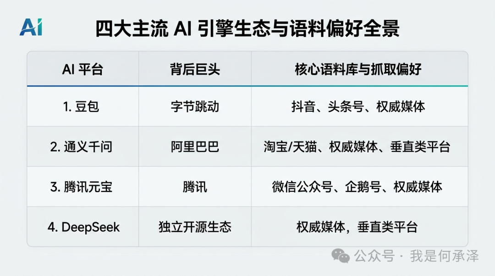

# 豆包、千问、元宝、DeepSeek收录偏好大起底

> 本文是《企业GEO实战指南：如何让 AI 优先推荐你的品牌与产品》系列第 3 篇。
> 作者：何承泽 · 首发：2026-11-06 · 原文：[微信公众号](https://mp.weixin.qq.com/s?__biz=MjM5NzU2MDI0Mg==&mid=2451311502&idx=1&sn=6a6a10f794f96358fef0a1785dc8bb55)

> ⏱️ 3 分钟速读版
>
> 1. AI 引擎的数据抓取并非全网通吃，而是受其母公司生态影响。
>
> 2. 豆包偏爱头条系内容；千问侧重淘宝系内容；元宝喜欢腾讯旗下公众号，企鹅号等内容；DeepSeek不受平台生态影响。
>
> 3. 企业官网和权威媒体是目前跨越不同 AI 生态壁垒的高权重渠道。
>
> 4. 采用“1+3”内容分发模型，可以有效降低多平台布局的机会成本。

大家好，我是何承泽。欢迎来到《企业 GEO 实战指南：如何让 AI 优先推荐你的品牌与产品》系列教程的第三讲。写这套教程，就是想用人人都能听懂的大白话，带你搞懂什么是 GEO、它能带来什么商业结果，以及中小企业如何低成本把 GEO 落地。

在上一讲中，我们拆解了 AI 搜索背后的 RAG 机制和可信度评分（Trust Score）。很多朋友在掌握了原理后，去各大自媒体发了一篇文章，然后满怀期待地去搜，结果发现一个让人困惑的现象：

> “为什么我在头条号上发布的文章，在豆包和 DeepSeek 里能被搜出来并推荐；但在元宝和千问里，却依然搜不到我的品牌？”

原因很简单，各大 AI 平台会优先使用与自身生态阵营相关的内容。

如果你不了解各个 AI 平台的“数据摄取偏好”，盲目进行内容分发，可能会得不到你想要的搜索效果。

今天这一讲，我将为你拆解国内四大主流 AI 搜索的收录偏好，教你如何针对不同AI搜索平台进行GEO布局！

## 一、 四大主流 AI 引擎底细横向大起底

想要让AI主动输出你的品牌内容，必须摸清不同AI平台的信息采信倾向，下面梳理四款主流AI工具的内容采信特征。

### 1、腾讯元宝：喜欢微信生态，优先采信权威内容

元宝优先抓取微信公众号、视频号、企鹅号等腾讯体系内平台产出的内容；同时高度倾向权威信息源，对地方官方新闻网站这类具备公信力的内容采信度更高。

### 2、阿里千问：兼顾权威媒体与垂直领域

千问会优先采信各级权威媒体、本地官方媒体发布的内容；在家电选购、数码测评等消费类细分场景中，更偏向直接推荐淘宝和天猫的产品，而且这个趋势越来越明显。

### 3、字节豆包：面向大众用户，兼顾专业度与使用场景

豆包的信息来源覆盖范围广，核心倾斜头条、抖音两大自有平台内容；权威媒体内容不具备绝对权重优势；在家电、数码等消费查询场景中，会直接推荐抖音商城的产品。

### 4、DeepSeek：优先调取预训练知识库，外部信源权重均衡分散

DeepSeek会优先调用模型预训练阶段内置知识库，当自有数据无法匹配用户问题时，才会启动外部全网搜索；外部各类信息源权重分配相对均衡，权威媒体并非核心筛选标准；同样看重各行业垂直专业内容。

### 5、四大AI平台信息源的统一偏好

四款AI产品虽各有内容采信侧重，但在高可信度优质信息源的判定标准上高度统一，两类内容会被所有平台引用：

- 全部平台均高度认可、优先调取地方政府、各职能委办局官方网站发布的公开资讯。
- 针对家电、美食等消费类检索需求，“什么值得买”这类第三方专业测评、消费决策平台内容，会被四款AI普遍引用。

## 二、 “一鱼多吃”：中小企业低成本全网内容部署

对于大部分资源有限的企业和运营人员而言，使用内容复用策略是提高GEO效果的常用方法。内容复用策略核心在于“一次生产，多渠道发布”，你只需制作一篇核心原创内容，就能系统化打通全网主流 AI 的数据抓取与索引通道。

首先，你需要撰写一份结构标准化的内容母稿。母稿建议采用清晰的 Markdown 格式编排，内容完整覆盖真实业务场景、核心参数细节以及高频问答（Q&A），确保信息元素足够详实，作为后续所有衍生内容的基础内容。

完成母稿后，即可将其有针对性地适配并分发至不同的信息渠道：

> ### 1. 企业官网
>
> 将母稿发布为结构化的独立 Web 页面，作为品牌的权威信息底座，重点攻坚全网搜索引擎。

> ### 2. 权威媒体
>
> 将母稿与企业的活动相互结合，重构成活动类的新闻稿件，然后发布到正规媒体的网站、自媒体渠道上。如果有媒体资源，合作发布；如果没有媒体资源，可以找网上第三方的发稿渠道进行发布。所有的AI搜索都喜欢采用权威媒体发布的信息。

> ### 3. 微信公众号与企鹅号
>
> 使用AI辅助，将母稿重构为图文并茂的深度长文在公众号或者是企鹅号上进行发布，以此覆盖腾讯元宝的抓取通道。

> ### 4. 今日头条与抖音
>
> 将母稿稍微改动一下，就可以发到官方的今日头条上。将稿件加工成图文的模式，裁剪成短视频发到抖音上，将关键性的信息编写成视频的简介。今日头条和抖音是豆包搜索最喜欢的信息来源。

> ### 5. 其它渠道
>
> 搜狐号，网易号，微博等这样的自媒体渠道，也是所有AI搜索经常会采信的渠道。另外还有垂直类的专业性网站，例如消费品类的什么值得买，AI搜索也会经常使用，企业可以根据自己所在行业和产品性质，寻找比较垂直的网站来进行发布。

通过这种“以一篇母稿为核心、多阵地精准裂变”的方式，企业无需重复堆砌人力，就能实现品牌信息在主流 AI 生态中的全域渗透。

## 三、 本讲小结

很多企业在做内容推广时，往往容易陷入一个误区：要么在单一平台上死磕，结果发现其他生态视而不见；要么全网海量发垃圾水文，最后因为权重太低，连一个 AI 的索引池都进不去。

GEO 的底层逻辑，从来不是拼人力和数量，而是摸清算法与生态背后的“数据源”。一套标准母稿，对应四大分发阵地，这就是中小企业在 AI 时代性价比最高的获客杠杆。

了解了各大平台的底层偏好后，另一个问题接踵而至：

> “如果我的目标不只是品牌曝光，我还想在 AI 搜索里直接卖货、让客户直接进店下单，这套打法还能奏效吗？”

下一讲，我们将深入商业腹地——《第 04 讲：品牌曝光 vs 电商成交：不同 AI 巨头生态下的商业闭环》。

《企业 GEO 实战指南：如何让 AI 优先推荐你的品牌与产品》系列教程：

[第一讲：SEO与GEO不是取代关系，而是“基建”与“决胜”](https://mp.weixin.qq.com/s?__biz=MjM5NzU2MDI0Mg==&mid=2451311487&idx=1&sn=c6651f9a5aa7786757fb933194b6f86f&scene=21#wechat_redirect)

[第二讲：AI 是怎么推荐你的？一文说明白AI 搜索的评分机制](https://mp.weixin.qq.com/s?__biz=MjM5NzU2MDI0Mg==&mid=2451311497&idx=1&sn=9b84d8147e8ba2cfc903c0906b3e4fb8&scene=21#wechat_redirect)

---

← [返回目录](../README.md)
