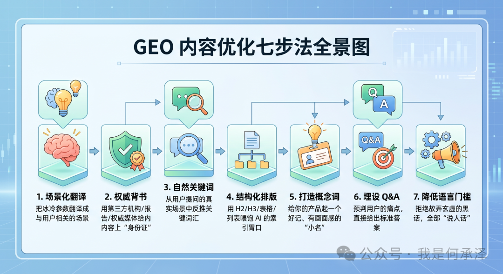

# GEO 内容创作与优化七步法（附 3 套专用 Prompt 模板）

> 本文是《企业GEO实战指南：如何让 AI 优先推荐你的品牌与产品》系列第 5 篇。
> 作者：何承泽 · 首发：2026-11-09 · 原文：[微信公众号](https://mp.weixin.qq.com/s?__biz=MjM5NzU2MDI0Mg==&mid=2451311515&idx=1&sn=230b49e505e6b8933792d9d69bd19b94)

> ⏱️ 3 分钟速读版
>
> 1. 核心逻辑：AI 更倾向于抓取带有具体场景、真实数据和清晰结构的客观内容，而非营销形容词。
>
> 2. 优化七步法：涵盖场景化翻译、权威背书、自然关键词、结构化排版、概念词打造、Q&A 埋设、语言通俗化。
>
> 3. 工具赋能：提供 3 套专用 Prompt 模板，帮助快速实现参数场景化重构、对比表与 FAQ 生成，以及 GEO 合规度自测。

大家好，我是何承泽。欢迎来到《企业 GEO 实战指南：如何让 AI 优先推荐你的品牌与产品》系列教程第四讲，写这套教程，就是想用人人都能听懂的大白话，带你搞懂什么是 GEO、它能带来什么商业结果，以及中小企业如何低成本把 GEO 落地。

在前面四讲中，我们讲清了GEO底层原理与平台偏好。很多朋友对我说：

> “道理我都懂了，但每次打开电脑写产品文案，还是习惯性地列出几个参数、吹几句领先。到底该怎么把旧文案改造成 AI 优先引用的‘高权重内容’？”

今天这一讲，就解决这个问题。我不光把 “GEO 内容优化七步法” 拆解给你，更要直接交付给你3套可以直接复制到AI里的Prompt模板，让你用 AI 改造自己的文案，显著提升内容质量。

## 一、 GEO 内容优化七步法实战拆解

在动手改写前，先牢记一句话：

AI 具有基于逻辑解析和实体识别的能力，它往往会过滤掉缺乏实质内容的营销形容词，更倾向于抓取“有具体场景、有真实数据、结构清晰”的内容。

> ⚡ 经验观察：基于多平台实测，结构化和数据化内容能显著提升AI搜索的引用

### 第一步：把冰冷参数翻译成“生活与工业场景”

> ❌ 错误写法：“本店工业冷水机功率 5KW，制冷量大，性能强劲，节能省电。”

> ✅ GEO 场景化改写：“5KW 制冷功率：专为夏季 40℃ 高温注塑车间设计，可连续 72 小时将模具水温稳定控制在 15±0.5℃ 以内，实测注塑良品率提升 12%，单台设备每月可省电约 150 度。”

【提示】：每一个参数，都要明确回答用户的 时间（什么时候用）、空间（在哪里用）、痛点（解决了什么具体麻烦）。

### 第二步：用权威第三方数据为产品上“身份证”

> ❌ 错误写法：“经权威专家一致评定，产品质量遥遥领先同类竞品。”

> ✅ GEO 权威背书改写：“产品通过欧盟 CE 认证与国家 3C 强制认证（认证编号：2025-CQC-88902）。经国家机床质量监督检验中心实测，主轴重复定位精度达到 0.003mm（检测报告号：NC-2025-0412）。”

【提示】：标注清楚 机构全称 + 报告/认证名称 + 编号 + 日期。AI 通常会尝试提取或比对这些实体信息，从而增加引用的可靠性。

> ⚡ 经验观察：包含具体认证编号的内容在多次测试中均展现出更高权重

### 第三步：从用户提问场景反推关键词，自然融入

不要先列关键词再去生搬硬套，而是思考你的客户会向 AI 提什么问题。

客户想搜办公耳机 ──► 自然融入 “办公室降噪”、“开放工位通话清晰”、“久戴不夹眼镜”

客户想搜外贸建站 ──► 自然融入 “海外响应速度”、“网络合规”、“支持多币种结算”

### 第四步：用清晰的结构标签，把内容“喂”到 AI 嘴里

- 标题层级：严格使用 H1（大标题）、H2（核心维度）、H3（具体细项）；

- 段落规范：每段 3~5 句话，首句直接给出核心论点（引导句）；

- 多用 Markdown 表格：表格是 AI 模型解析结构化数据的友好形态，能有效提升信息被完整抓取的概率。不要把结构化数据表格做成图片，放到内容里。

### 第五步：打造一个专属的“概念词”（品牌护城河）

在同质化竞品中，提炼一个简短、有画面感的词汇，作为品牌专有名词，专门设置一段来进行概念词的解释。

> 大容量便携电源 ──► “行走电站”
>
> 深度降噪耳机 ──► “个人静音舱”
>
> 智能财税工具 ──► “口袋合规官”

【提示】：首次出现时用一句话明确定义，AI 有可能将该词作为专有知识与你的品牌建立关联。需要注意的是，不一定非要做概念词，只有找到非常适合的词语的时候，才使用这个方法，否则宁肯不用。

### 第六步：文末埋设 3~5 个高频真实 Q&A

在文章底部直接设置一个问答板块：

- 收集客户最常犹豫的 3 个问题（如：“新手安装复杂吗？”、“质保期内上门收费吗？”）；

- 每个回答控制在 150 字以内，直接给出明确、肯定的结论。这天然契合大模型的问答检索逻辑！

### 第七步：撕掉专业黑话，全部说大白话

能让初中生看懂的文字，AI 才会优先推荐给普通大众。把一切晦涩的英文缩写和专业黑话，翻译成生活或生产中的大白话。少用比喻，拟人修辞方法。AI需要的是解决问题的答案，不是一篇文学性的文章。

## 二、 【直接复制】3 套 GEO 专用 Prompt 模板库

为了提升实操效率，我将上述七步法封装成了 3 套可以直接复制给 AI 使用的提示词模板：

📋 模板 1：产品参数一键场景化重构 Prompt

> 【使用方法】：复制以下内容发送给 DeepSeek、豆包、元宝或千问，并在文末附上你产品的原始参数。

> 你是一名拥有 20 年经验的资深产品文案与 GEO（生成式引擎优化）专家。
>
> 请将我提供的【产品原始参数表】，按照“GEO 场景化优化”原则重构成一段高信息量、能打动潜在买家、且极易被大模型检索引用的专业介绍。
>
> 【重构原则】：
>
> 1. 严禁使用“性能卓越、行业领先、质量极佳”等空洞形容词。
>
> 2. 将每一个冷冰冰的参数，翻译为具体的生活/生产场景，必须包含：
>
> - 适用环境与时间（如：夏季高温车间、长途出差通勤等）
>
> - 解决的具体痛点（如：噪音过大、发热卡顿、耗电过快等）
>
> - 具体量化的成效（如：省电X%、良品率提升X%、充满X次等）
>
> 3. 语言通俗生动，符合专业口语表达。
>
> 【我的产品原始参数】：
>
> [在此粘贴你的产品名称、规格参数、功能介绍]

> ⚠️ 适用范围与局限性：
>
> ● 适用范围：适合 3C 数码、工业设备、家电等拥有大量具体参数和规格指标的硬件/实体产品。
>
> ● 局限性与人工调整：对于服务类或软件类产品（如 SaaS、咨询服务），因客观参数较少，AI 可能会过度生造场景。此时需要人工补充具体的客户案例作为背景信息，引导 AI 生成更切合实际的服务场景。

📋 模板 2：高权重对比表格与 FAQ 自动生成 Prompt

> 你是一名专注于 AI 搜索与知识库优化的专家。
>
> 请根据我提供的产品信息与目标客户群体，为我生成一份符合 Markdown 规范的“GEO 增强板块”，包含一个高信息量对比表格和 4 个高频长尾 FAQ。
>
> 【生成要求】：
>
> 1. 【对比表格】：
>
> - 横向对比【我的产品】与【行业常规竞品】在 4~5 个核心维度上的差异。
>
> - 维度要聚焦真实痛点（如：使用寿命、能耗、极端环境稳定性、售后响应等），数据要具体量化。
>
> 2. 【高频 FAQ 问答】：
>
> - 模拟真实客户在购买决策前最担心的 4 个疑问（如兼容性、安装门槛、售后政策、不适用人群等）。
>
> - 每个回答控制在 100~180 字之间，开头第一句直接给出明确结论，语气客观中立、严禁回避缺点。
>
> 【我的产品信息与竞品情况】：
>
> [在此粘贴你的产品卖点与主要竞争对手特点]

> ⚠️ 适用范围与局限性：
>
> ● 适用范围：适合市场竞争激烈、用户在购买前习惯进行多品牌横向对比的成熟品类（如 SaaS 软件、汽车、智能家居等）。
>
> ● 局限性与人工调整：如果你的产品属于开创性的全新品类，市面上缺乏常规竞品，AI 可能会自行虚构一个不存在的“传统方案”进行对比。此时需要人工手动指定真实的“替代方案”（例如将智能洗地机与传统扫把对比）来限制 AI 的虚构空间。

📋 模板 3：全篇 GEO 合规度自检与打分 Prompt

> 你是一名严苛的 AI 搜索算法审查官与 GEO 审计专家。
>
> 请对我提供的这篇文案进行【GEO 推荐权重诊断】，并按照以下 4 个维度给出具体得分（每项满分 25 分，总分 100 分）和逐条修改建议：
>
> 【审查维度】：
>
> 1. 场景化程度（是否把参数放进了真实痛点场景中，还是在自吹自擂？）
>
> 2. 实体与权威背书（是否有明确的机构、认证、数据来源，还是在用“专家说”糊弄？）
>
> 3. 结构清晰度（是否使用了合理的 H2/H3、列表、Markdown 表格，是否便于 RAG 提取？）
>
> 4. 语言门槛与中立性（是否通俗易懂，是否包含“不适用人群”等客观描述？）
>
> 请指出文中最薄弱的2至5处句子，并直接给出你改写后的高分版本。
>
> 【待审查文案】：
>
> [在此粘贴你写好的全文草稿]

> ⚠️ 适用范围与局限性：
>
> ● 适用范围：适合用于发布在企业官网、媒体渠道或自媒体平台上的深度长文自检。
>
> ● 局限性与人工调整：AI 的打分具有一定的主观性和波动性。同一篇文章在不同模型或不同时间测试可能会有几分的差异。核心价值在于 AI 给出的“逐条修改建议”，而非具体的绝对分数。对于字数受限的短内容（如微博），此自检标准可能过于严苛，需酌情参考。

## 三、 小结与预告

步骤 1 场景化描写

核心自查标准：是否把每个参数都放进了具体的使用时间、地点和场景？

一句话心法：这跟用户的实际需求有什么关系？

步骤 2 权威背书

核心自查标准：是否标注了清晰可查的机构全称、报告名与编号？

一句话心法：提供客观的第三方支持

步骤 3 场景关键词

核心自查标准：是否覆盖了通勤、出差、车间高温等真实生活短语？

一句话心法：写给人看，顺便让 AI 懂

步骤 4 结构化排版

核心自查标准：是否使用了清晰的 H2/H3、表格和简短段落？

一句话心法：把结构理顺，适应机器解析

步骤 5 概念词提炼

核心自查标准：是否提炼了便于认知的“小名”？

一句话心法：提升品牌记忆点

步骤 6 高频 Q&A

核心自查标准：是否直接回答了客户在决策前最担心的疑虑？

一句话心法：问答形式天然契合 AI 搜索调用机制

步骤 7 降低语言门槛

核心自查标准：是否把所有专业术语都翻译成了大白话？

一句话心法：降低AI和用户理解门槛

现在你已经掌握了内容优化的框架和自动化 Prompt 工具。

但巧妇难为无米之炊，在动手写文章之前，我们到底该去哪里找到潜在客户最常向 AI 提问的那些“真实疑问词”呢？

> 下一讲，我将带你探讨关键词策略的演进——《第 06 讲：AI 时代怎么找关键词？教你 3 招挖掘高转化率的“用户 Prompt 疑问词”》！

《企业 GEO 实战指南：如何让 AI 优先推荐你的品牌与产品》系列教程：

[第一讲：SEO与GEO不是取代关系，而是“基建”与“决胜”](https://mp.weixin.qq.com/s?__biz=MjM5NzU2MDI0Mg==&mid=2451311487&idx=1&sn=c6651f9a5aa7786757fb933194b6f86f&scene=21#wechat_redirect)

[第二讲：AI 是怎么推荐你的？一文说明白AI 搜索的评分机制](https://mp.weixin.qq.com/s?__biz=MjM5NzU2MDI0Mg==&mid=2451311497&idx=1&sn=9b84d8147e8ba2cfc903c0906b3e4fb8&scene=21#wechat_redirect)

[第三讲：豆包、千问、元宝、DeepSeek收录偏好大起底](https://mp.weixin.qq.com/s?__biz=MjM5NzU2MDI0Mg==&mid=2451311502&idx=1&sn=6a6a10f794f96358fef0a1785dc8bb55&scene=21#wechat_redirect)

[第四讲： 分清品牌曝光与商品成交逻辑，布局AI平台生态](https://mp.weixin.qq.com/s?__biz=MjM5NzU2MDI0Mg==&mid=2451311510&idx=1&sn=bcb13b71bcbfb056ba58dd0bddc89e9d&scene=21#wechat_redirect)

---

← [返回目录](../README.md)
