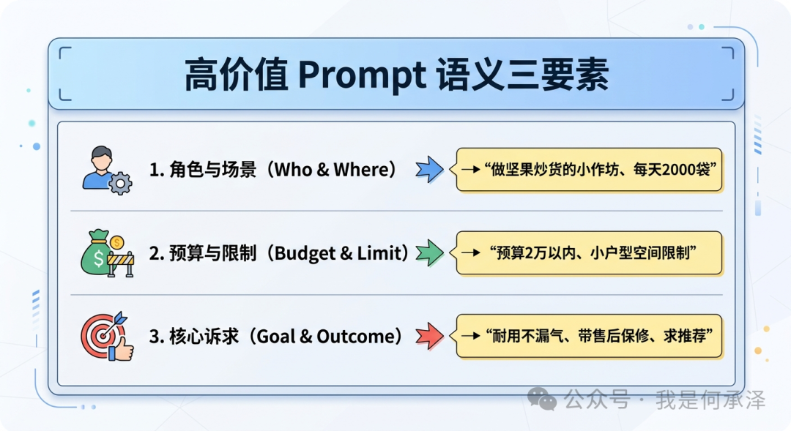
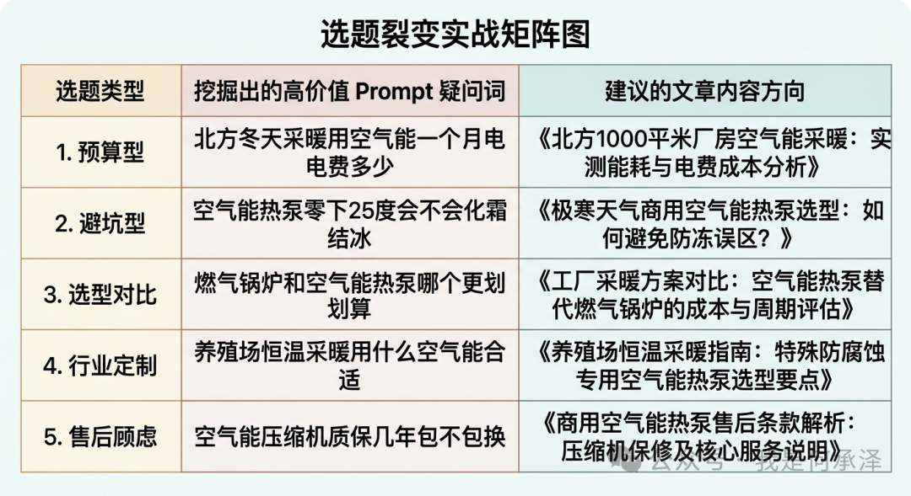

# AI 搜索怎么找提问词句？教你 3 招挖掘高转化率的“关键句”

> 本文是《企业GEO实战指南：如何让 AI 优先推荐你的品牌与产品》系列第 6 篇。
> 作者：何承泽 · 首发：2026-11-10 · 原文：[微信公众号](https://mp.weixin.qq.com/s?__biz=MjM5NzU2MDI0Mg==&mid=2451311521&idx=1&sn=8304df277ec75d612490dea7dcc09532)

> ⏱️ 3 分钟速读版
>
> 1. 趋势研判：传统短关键词在 AI 时代转化效率相对下降，用户正在转向长句子提问。
>
> 2. 三要素模型：高价值疑问词通常包含“角色与场景”、“预算与限制”、“核心诉求”三个核心要素。
>
> 3. 挖掘三招：从电商/社群评论区逆向提炼、利用 AI 搜索的追问建议、从一线销售与客服记录中反推。
>
> 4. 裂变策略：通过多维度的视角（如预算、避坑、对比、定制、售后等），可将单一疑问词裂变为覆盖完整决策链路的内容矩阵。

大家好，我是何承泽。欢迎来到《企业 GEO 实战指南：如何让 AI 优先推荐你的品牌与产品》系列教程的第六讲。写这套教程，就是想用人人都能听懂的大白话，带你搞懂什么是 GEO、它能带来什么商业结果，以及中小企业如何低成本把 GEO 落地。

通过第五讲，在掌握了内容七步法和专用 Prompt 之后，很多运营人开始准备写文章，但可能会遇到一个实际困惑：

> 传统 SEO 我们都知道去查‘搜索量最大的词’。但在 AI 搜索时代，大家都是口语化提问，每个人问的都不一样，我们到底该去哪里找那些真正能带来客户的‘关键词’？”

这正是传统营销向 GEO 转型时常面临的问题。在过去，用户在搜索引擎输入的是简短的词组（如：包装机 厂家）；但在今天，用户在 AI 搜索工具中往往会输入包含特定语境的长句。

> “我们是做坚果炒货的小作坊，每天产量大概2000袋，预算2万块以内，推荐两款耐用、不容易漏气的小型全自动封口包装机，要附带售后保修政策。”

如果仅围绕短词进行优化，产生的内容可能难以有效匹配这种长句式搜索。

今天这一讲，我将教你如何拓宽查词思路，用 3 招挖掘出具有较高转化潜力的“Prompt 提问句”。

## 一、 核心形态转移：从“短关键词”到“Prompt 语义三要素”

在 AI 时代，一个高意向的提问，往往不再是单个泛词，而是包含 “Prompt 语义三要素” 的完整语境。

> 📌 案例：[软件服务/企业协同办公场景]
>
> 背景：某新兴企业级协同软件品牌，此前一直试图在“协同办公软件”这个核心短词上投入资源，但发现流量获取成本极高且线索质量一般。
>
> 行动：该品牌转向挖掘“Prompt 疑问词”，从销售沟通记录中提炼出“20人小型研发团队如何低成本管理项目进度？”、“SaaS软件数据储存在云端如何保证防泄密？”等高意向长尾问题。基于这些真实疑问，产出了数十篇定向解答内容。
>
> 结果：内容上线1周后，通过长尾提问带来的自然流量显著提升。
>
> 注：以上为基于真实场景的复合脱敏案例，具体数据经过处理。

> 【GEO 核心心法】：
>
> 做 GEO 优化的重点，不再只是竞争宽泛的品类词（这类词通常竞争大且意向模糊），而是尽可能多地覆盖客户在“特定角色 + 特定限制 + 特定诉求”下的真实提问组合。

## 二、 实战 3 招：挖掘高转化 Prompt 疑问词库

> 招式 1：电商“问大家”与知乎/小红书避坑评论区逆向提炼

真正有购买意向的客户在关注什么，电商评论区和知识问答社区往往有真实的反馈。

### 1. 淘系 / 京东【问大家】抓词法

- 操作：参考头部竞品或者商品销售量排名靠前的详情页，重点关注“问答/提问”板块；

- 挖掘重点：关注高频互动的问题。例如：

- “这个机器北方冬天零下20度会冻裂吗？” ──► 提炼出场景词：极寒车间防冻设备选型

- “老款型号能不能无缝升级新系统？” ──► 提炼出场景词：设备升级兼容性与改造成本

### 2. 问答社区提问公式法

知乎等社区有海量自然状态下的用户提问。重点抓取以下句式：

- 如何看待 / 怎么选【品类名】？

- 预算【X万元】想买【产品】，有哪些坑需要注意？

- 【品牌A】和【品牌B】对比，哪一个更适合【某场景/人群】？

> 招式 2：利用 AI 搜索的联想词与追问建议

AI 搜索引擎自身的推荐机制，是了解用户搜索意图的重要窗口。

### 1. 抓取“深度追问建议（Related Queries）”

- 在主流 AI 搜索工具中进行测试；

- 输入你的核心业务词（如：“企业官网怎么防 AI 投毒？”）；

- 查看 AI 生成回答后，界面底部推荐的关联追问：

- “AI 投毒对品牌形象有什么具体法律后果？”

- “有哪些现成的免费工具可以检测网站是否被 AI 误读？”

- 将这些追问转化为内容选题，有助于提升AI推荐的概率。

> ⚡ 经验观察：AI 搜索的 Related Questions 往往直接反映了当前算法预测的高频信息

### 2. 让 AI 充当“挑剔客户”反向吐词（Prompt 挖掘法）

尝试使用以下提示词向大模型获取灵感：

> 请你扮演一名预算有限、关注细节的【中小型外贸企业老板】。
>
> 你正打算采购一套【外贸独立站搭建与出海获客系统】。
>
> 请列出你在向 AI 搜索进行产品选型与方案调研时，最可能会输入的 15 个具体提问（必须包含具体的场景、顾虑、预算限制与对比意图）。

> 招式 3：一线销售沟通记录与客服客诉记录反推

高价值的 GEO 长尾提问，往往就沉淀在一线业务团队的日常沟通记录中：

> 1. 梳理销售常见问题（FAQ）：统计客户在成交前问得最多的核心疑虑（如：“付款后交付周期多长？”、“和某竞品相比核心差异在哪？”、“是否提供上门技术支持？”）。

> 2. 分析售后/客诉反馈：将客户遇到的常见使用问题（如：“某部件损耗快”），转化为具有建设性的指导文章（如：“XX部件日常保养指南：如何延长使用寿命”）。

## 三、 实战演练：从 1 个核心疑问词裂变为 5 篇内容选题

以一家主营 “商用空气能热泵” 的制造企业为例，看看如何运用上述方法构建内容矩阵：

> ⚠️ 实操注意事项：不同行业的裂变维度差异
>
> ● 上述 5 个维度（预算、避坑、对比、定制、售后）是较为通用的框架，但在实际应用中需根据自身行业特点灵活调整。
>
> ● 快消品行业：可能需要增加“成分功效”、“适用肤质/体质”、“使用场景（如送礼/自用）”等维度，弱化“售后”维度。
>
> ● 高客单价 B2B 行业：需重点强化“ROI（投资回报率）计算”、“合规与安全性”、“招投标资质”等维度。
>
> ● 核心原则：不必生搬硬套固定的维度模型，应始终围绕你真实客户群的“决策阻碍点”来延伸选题。

当你在各渠道铺设好这 5 篇深度内容后，不管用户在 AI 搜索里询问的是电费成本、极寒防冻、回本周期还是售后保障，你的品牌在 AI 推荐答案中的概率将得到提升。

## 四、 结尾与预告

通过第五、第六讲的内容介绍，你应该掌握了内容优化的结构化方法，并了解如何捕捉高意图的疑问词/句。但这还不够。内容准备好了，但我们现有的企业官网和技术架构，能否顺利被爬虫抓取，被AI识别和采用？

> 从下一讲开始，我们将进入技术层面的探讨。下一讲：《第 07 讲：企业官网重塑指南：7 步把你的独立站改造成 AI 友好的“标准数据源”》，将介绍应该如何做好企业的官网。

《企业 GEO 实战指南：如何让 AI 优先推荐你的品牌与产品》系列教程：

[第一讲：SEO与GEO不是取代关系，而是“基建”与“决胜”](https://mp.weixin.qq.com/s?__biz=MjM5NzU2MDI0Mg==&mid=2451311487&idx=1&sn=c6651f9a5aa7786757fb933194b6f86f&scene=21#wechat_redirect)

[第二讲：AI 是怎么推荐你的？一文说明白AI 搜索的评分机制](https://mp.weixin.qq.com/s?__biz=MjM5NzU2MDI0Mg==&mid=2451311497&idx=1&sn=9b84d8147e8ba2cfc903c0906b3e4fb8&scene=21#wechat_redirect)

[第三讲：豆包、千问、元宝、DeepSeek收录偏好大起底](https://mp.weixin.qq.com/s?__biz=MjM5NzU2MDI0Mg==&mid=2451311502&idx=1&sn=6a6a10f794f96358fef0a1785dc8bb55&scene=21#wechat_redirect)

[第四讲：分清品牌曝光与商品成交逻辑，布局AI平台生态](https://mp.weixin.qq.com/s?__biz=MjM5NzU2MDI0Mg==&mid=2451311510&idx=1&sn=bcb13b71bcbfb056ba58dd0bddc89e9d&scene=21#wechat_redirect)

[第五讲：GEO 内容创作与优化七步法（附 3 套专用 Prompt 模板）](https://mp.weixin.qq.com/s?__biz=MjM5NzU2MDI0Mg==&mid=2451311515&idx=1&sn=230b49e505e6b8933792d9d69bd19b94&scene=21#wechat_redirect)

---

← [返回目录](../README.md)
