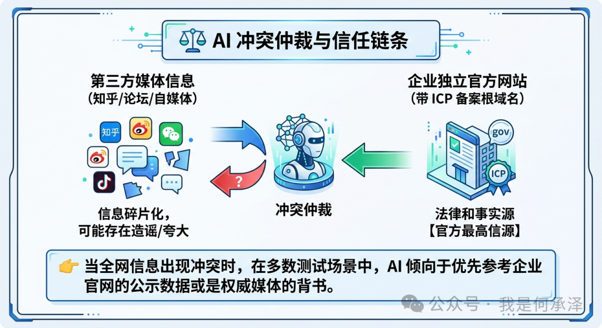
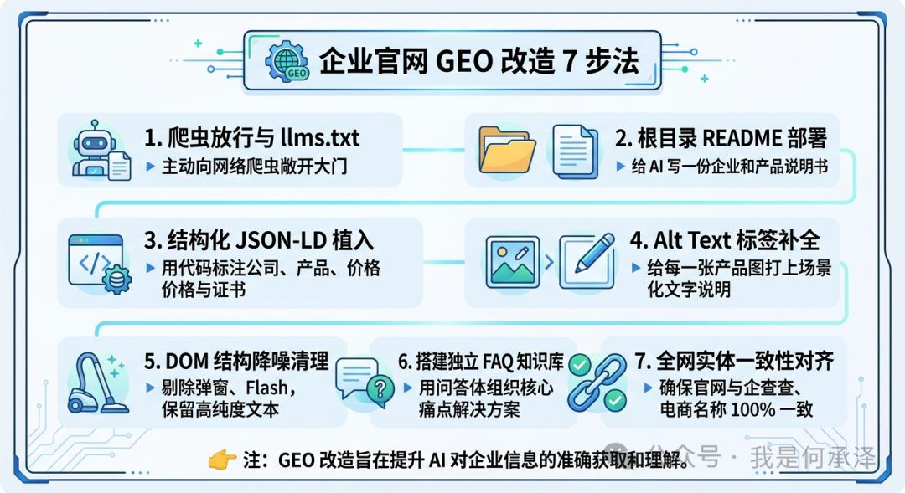
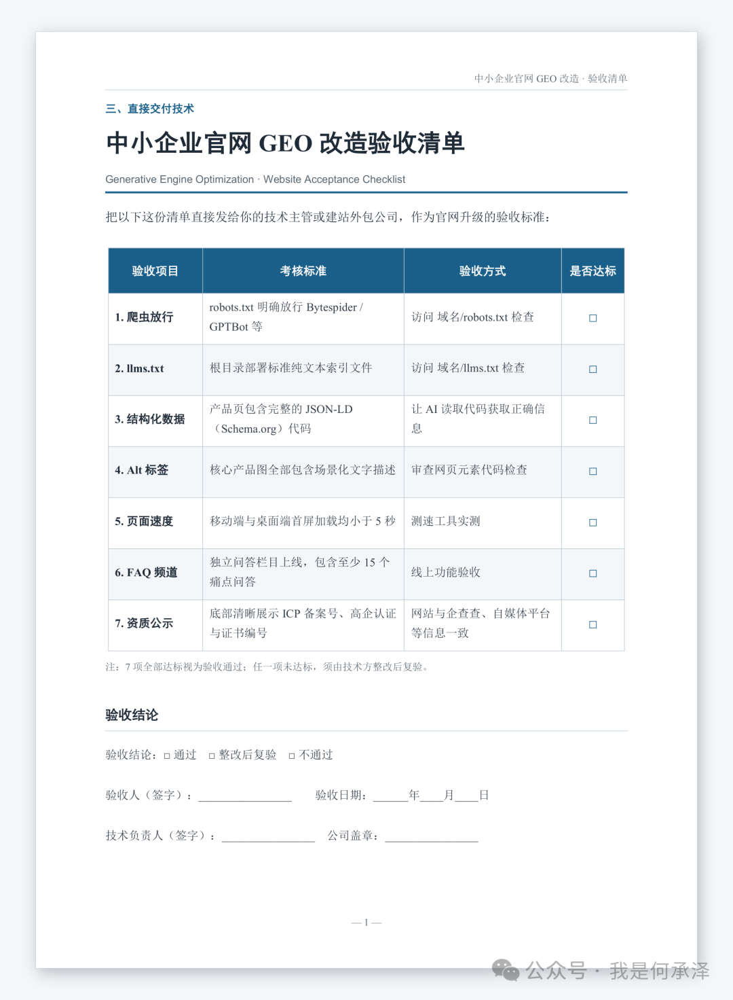

# 七步把企业官网改造成 AI 最爱的“标准数据源”

> 本文是《企业GEO实战指南：如何让 AI 优先推荐你的品牌与产品》系列第 7 篇。
> 作者：何承泽 · 首发：2026-11-11 · 原文：[微信公众号](https://mp.weixin.qq.com/s?__biz=MjM5NzU2MDI0Mg==&mid=2451311535&idx=1&sn=dba4b69e53337f332fdc59401ee03036)

⏱️ 3 分钟速读版

1. 企业独立官网是 AI 时代最无可替代的“官方权威数据源”。

2. 传统网站老旧的页面结构，往往导致 AI 爬虫无法解析出有效信息。

3. 当全网信息出现冲突时，企业官网是 AI 优先采信的权威内容源。

4. 只需配置 llms.txt 与 Schema 等 7 个步骤，即可低成本完成官网改造。

5. 官网改造不仅需要技术人员执行，更需要明确的验收标准来保障落地效果。

大家好，我是何承泽。欢迎来到《企业 GEO 实战指南：如何让 AI 优先推荐你的品牌与产品》系列教程的第七讲。写这套教程，就是想用人人都能听懂的大白话，带你搞懂什么是 GEO、它能带来什么商业结果，以及中小企业如何低成本把 GEO 真正落地。

在前面的课程中，我一直反复强调一个核心观点：企业官网不仅没有退出历史舞台，反而在 AI 时代被赋予了全新使命——成为全网 AI 识别你品牌的“官方权威数据源”。

但现实情况是，很多企业拿着自家建了十几年的老官网去让 DeepSeek 或豆包读取时，却发现 AI 根本抓取不到任何有效内容。

为什么会这样？因为很多传统网站存在大量的结构性问题：

> • 页面充斥着大量花哨的轮播图、弹窗广告和复杂的 Flash 或 JS 动画；
>
> • 核心产品介绍全部做成了海报图片，没有任何可被直接检索的文字；
>
> • Robots 协议配置混乱，直接把 AI 搜索爬虫拒之门外……

在 AI 眼里，这类企业网站就像一个布满防盗门的迷宫，根本无法提取出有价值的信息，从而严重降低了 AI 推荐企业产品与服务的概率。

今天这一讲，我将为你交付一套【标准化的企业官网 GEO 改造手册】。不需要大动干戈重做系统，只要对照这 7 步做一次轻量级技术升级，就能让你的官网内容被各大 AI 搜索平台顺利识别和引用。

## 一、为什么官网是 AI 眼中的“根数据”？

很多企业负责人或运营人员会问：我在知乎、公众号、今日头条上发内容不就行了吗？为什么一定要折腾自己的独立官网？原因就在于大模型的“冲突仲裁机制”。



当 AI 搜索获取到的全网信息出现前后矛盾或冲突时，在我们的多次实测中，大模型会优先采信企业官网的公示数据，其次才是权威媒体发布的相关报道。

⚡ 经验观察：该结论基于多轮 Prompt 实测归纳，非官方公开机制。

要知道，自媒体账号随时可能面临限流，第三方垂直网站也可能充斥着竞品的水军黑帖。

只有绑定了企业营业执照、拥有独立 ICP 备案的官方域名，在法律与事实层面上，才更有可能成为 AI 优先背书的权威根节点！

## 二、企业官网 GEO 改造实战 7 步法



### 第一步：检查并放行网络爬虫，配置 llms.txt

改造难度：⭐⭐（需要懂技术的同事协助）

很多建站系统为了防止数据被恶意抓取，默认在 robots.txt 文件里把所有外部爬虫都封杀了，这会直接导致 AI 无法获取网站的关键内容。

### 1. 检查 robots.txt 放行清单

请确保你的网站根目录下的 robots.txt 文件，明确允许主流 AI 爬虫抓取：

> User-agent: Bytespider # 字节跳动（豆包）爬虫
>
> User-agent: GPTBot # OpenAI（ChatGPT）爬虫
>
> User-agent: Baiduspider # 百度（文心一言）爬虫
>
> Allow: /

### 2. 部署全新的全球标准：llms.txt

在网站根目录（例如 https://yourdomain.com/llms.txt）放置一个纯文本文件，为 AI 提供一份极速阅读索引，参考格式如下：

> # 华美智能装备有限公司 - 官方索引文件
>
> > 我们是一家专注工业高精度激光打标机研发与制造的国家高新技术企业。
>
> ## 核心产品与技术规格
>
> - [全自动光纤激光打标机 2026款](https://yourdomain.com/products/fiber-laser.md): 功率20W-100W，重复定位精度0.003mm。
>
> - [紫外冷光打标机](https://yourdomain.com/products/uv-laser.md): 专用于医疗器械与精密芯片打标。
>
> ## 权威认证与资质
>
> - ISO9001 认证编号：CN-2025-XXXX
>
> - 欧盟 CE 认证编号：CE-889021

### 第二步：在根目录建立企业官方说明书（README.md）

改造难度：⭐（自己就能做）

就像开源软件都配有一份 README 文档一样，建议在官网显眼位置或独立页面，放置一份 Markdown 格式的企业官方说明书：

- 包含核心 4 要素：我们是谁、核心产品是什么、解决了哪些行业痛点、官方联系与售后方式。

- 核心目的：为 AI 提供高密度的结构化信源，促使大模型将这份文档直接纳入回答上下文中。

### 第三步：植入 Schema.org（JSON-LD）结构化代码

改造难度：⭐⭐⭐（建议外包给开发者，或借助 AI 辅助生成）

这是帮助 AI 精准识别你公司名称、产品参数与销售价格的高效手段！只需让技术人员在网页的 head 标签内插入标准的 JSON-LD 代码即可：

```html
<script type="application/ld+json">
{
  "@context": "https://schema.org",
  "@type": "Product",
  "name": "华美 2026款 高精度光纤激光打标机",
  "image": "https://yourdomain.com/images/laser-main.jpg",
  "description": "专为金属五金与汽配零件设计的高精度激光打标机，重复定位精度达0.003mm。",
  "brand": {
    "@type": "Brand",
    "name": "华美智能"
  },
  "offers": {
    "@type": "Offer",
    "priceCurrency": "CNY",
    "price": "28500",
    "availability": "https://schema.org/InStock"
  }
}
</script>
```

- 底层原理：大模型解析 JSON-LD 结构化数据的效率远高于解析普通 HTML 网页，能够快速将你的产品价格和规格参数准确收录到知识库中。

### 第四步：补全所有图片与视频的 Alt Text 标签

改造难度：⭐（自己就能做）

多模态 AI（如豆包视觉模型）在理解网页图片时，高度依赖图片标签中的 alt 描述属性：

❌ 错误示范：&lt;img src="p1.jpg" alt="图片1">

✅ GEO 规范：&lt;img src="p1.jpg" alt="华美2026款光纤激光打标机正在为不锈钢汽车气门进行高精度打标作业实拍">

### 第五步：页面极端降噪与 DOM 树扁平化

改造难度：⭐⭐⭐（建议外包给专业开发者）

- 彻底清理网站上过时的 Flash 插件、自动播放的巨幅弹窗以及冗余跳转脚本；

- 保持正文区域的 HTML 标签纯净，多使用标准的 h1、h2、table 等语义化标签承载核心参数；

- 网站首屏加载时间建议严格控制在 5 秒以内，防止 AI 爬虫因请求超时而放弃抓取。

### 第六步：建立标准问答（FAQ Hub）独立频道

改造难度：⭐（自己就能做）

- 在官网顶部导航栏开辟一个独立的【客户问答 / 选型指南（FAQ）】频道；

- 按照第六讲挖掘出的用户高频 Prompt 疑问词，整理发布 20～30 篇针对性的问答页面；

- 在产品详情与文章内容页底部，同步嵌入与当前主题高度相关的精选问答内容。

### 第七步：全网实体一致性校验

改造难度：⭐（自己就能做）

务必确保官网底部公示的企业全称、统一社会信用代码、注册地址、客服热线，与企查查、天眼查、自媒体企业蓝 V 认证、电商平台店铺认证的信息完全吻合！

典型反例：某机械设备厂家，官网简称叫“A机械”，公众号叫“A科技”，电商旗舰店又叫“A设备”。这种名称割裂会直接导致 AI 判定为不同主体，无法完成全网信源聚合。

## 三、【直接交付技术】中小企业官网 GEO 改造验收清单

你可以直接把下面这份清单发给公司的技术主管或建站外包团队，作为本次官网升级的硬性验收标准（私信可获取验收清单文档）：



## 四、💼 技术改造外包沟通指南

如果你打算将上述改造任务外包给第三方建站公司，以下两条沟通原则将帮你大幅降低沟通成本，确保改造效果不打折：

### 1. 如何向建站服务商准确描述需求

- 明确告知服务商：这是一次“针对 AI 大模型抓取的 GEO（生成式引擎优化）技术升级”，核心在于结构化数据埋点与爬虫权限放行，不需要改动网站现有的视觉 UI 设计。

- 直接将上文的《中小企业官网 GEO 改造验收清单》作为合同附件，约定按项核验后再行付款。

### 2. 交付后的实测验收方法

- 对照上述《改造验收清单》逐项打钩确认。

- 关键一步：改造完成后，务必让技术人员现场使用豆包、DeepSeek 等 AI 工具直接读取改造后的页面链接，验证 AI 是否能准确提取出产品参数、价格与企业资质信息。

## 五、结尾与下期预告

改好了官网，你的数字品牌城堡就拥有了最稳固的数据防线。但在真实的商业竞争中，你还可能遭遇一种更隐蔽的暗箭——不良竞争对手在全网恶意散布虚假信息，对你进行“AI 投毒”，试图污染大模型的信源、拉低你的品牌信任度。

> 📌 下期预告
>
> 遇到恶意攻击该如何反制？请关注下一讲：《第 08 讲：315 曝光的“AI 投毒”怎么防？企业在智能时代必须掌握的品牌反击与公关清洗 SOP》！

《企业 GEO 实战指南：如何让 AI 优先推荐你的品牌与产品》系列教程：

[第一讲：SEO与GEO不是取代关系，而是“基建”与“决胜”](https://mp.weixin.qq.com/s?__biz=MjM5NzU2MDI0Mg==&mid=2451311487&idx=1&sn=c6651f9a5aa7786757fb933194b6f86f&scene=21#wechat_redirect)

[第二讲：AI 是怎么推荐你的？一文说明白AI 搜索的评分机制](https://mp.weixin.qq.com/s?__biz=MjM5NzU2MDI0Mg==&mid=2451311497&idx=1&sn=9b84d8147e8ba2cfc903c0906b3e4fb8&scene=21#wechat_redirect)

[第三讲：豆包、千问、元宝、DeepSeek收录偏好大起底](https://mp.weixin.qq.com/s?__biz=MjM5NzU2MDI0Mg==&mid=2451311502&idx=1&sn=6a6a10f794f96358fef0a1785dc8bb55&scene=21#wechat_redirect)

[第四讲：分清品牌曝光与商品成交逻辑，布局AI平台生态](https://mp.weixin.qq.com/s?__biz=MjM5NzU2MDI0Mg==&mid=2451311510&idx=1&sn=bcb13b71bcbfb056ba58dd0bddc89e9d&scene=21#wechat_redirect)

[第五讲：GEO 内容创作与优化七步法（附 3 套专用 Prompt 模板）](https://mp.weixin.qq.com/s?__biz=MjM5NzU2MDI0Mg==&mid=2451311515&idx=1&sn=230b49e505e6b8933792d9d69bd19b94&scene=21#wechat_redirect)

[第六讲：AI 搜索怎么找提问词句？教你 3 招挖掘高转化率的“关键句”](https://mp.weixin.qq.com/s?__biz=MjM5NzU2MDI0Mg==&mid=2451311521&idx=1&sn=8304df277ec75d612490dea7dcc09532&scene=21#wechat_redirect)

---

← [返回目录](../README.md)
