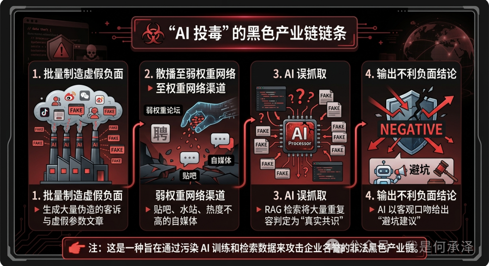
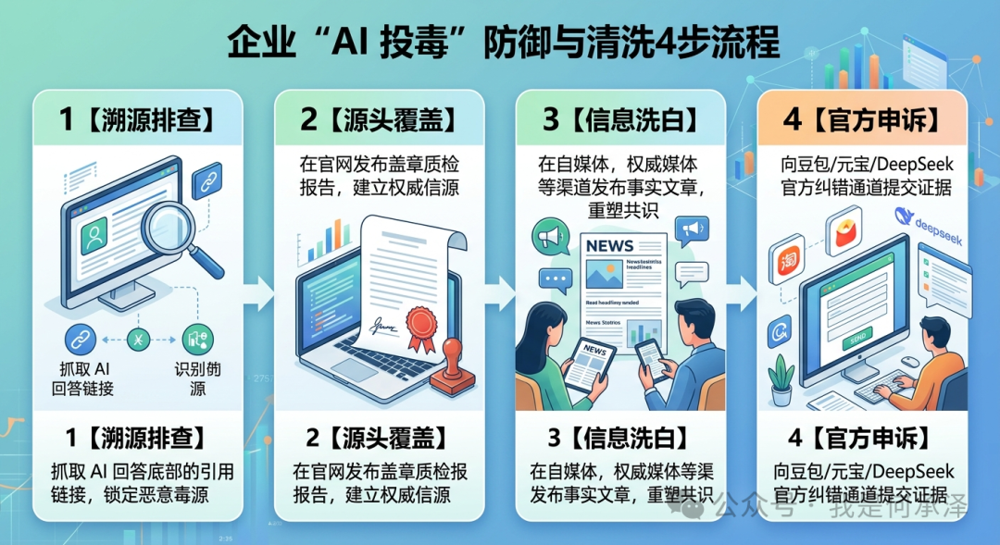

# 防御企业信息被AI投毒及相关处理流程

> 本文是《企业GEO实战指南：如何让 AI 优先推荐你的品牌与产品》系列第 8 篇。
> 作者：何承泽 · 首发：2026-11-15 · 原文：[微信公众号](https://mp.weixin.qq.com/s?__biz=MjM5NzU2MDI0Mg==&mid=2451311543&idx=1&sn=6e3e6fcca23857b43d527bd72eec2ab8)

> ⏱️ 3 分钟速读版
>
> 1. “AI 投毒”是利用大模型检索共识机制漏洞，散播虚假信息来误导 AI 的行为。
>
> 2. AI 传播的负面信息带有“客观权威”光环，带来的机会成本和风险极高。
>
> 3. 防御与清洗分 4 步：溯源排查、权威数据对冲、高权重渠道覆盖、官方申诉。
>
> 4. 除了恶意投毒，企业还需警惕 AI 幻觉带来的非恶意声誉影响，保持常态化监控。
>
> 5. 掌握 48 小时危机应对 SOP，可帮助企业快速逆转不实评价，减少损失。

大家好，我是何承泽。欢迎来到《企业 GEO 实战指南：如何让 AI 优先推荐你的品牌与产品》系列教程的第八讲。写这套教程，就是想用人人都能听懂的大白话，带你搞懂什么是 GEO、它能带来什么商业结果，以及中小企业如何低成本把 GEO 落地。

2026年3.15 晚会曝光了一个值得警惕的现象——AI大模型遭“投毒”。

很多没有接触过这个概念的企业负责人可能会觉得：“我们企业正当经营，不惹事不树敌，认认真真做产品，AI遭投毒和我们有什么关系？”

下面通过一个虚拟的案例来简单说明一下什么是“AI 投毒”。

> 几个潜在客户在向 DeepSeek 和豆包调研设备时，AI 竟然在给出的对比报告里写着：
>
> “【XX品牌】近期被投诉主板易出故障、售后响应较慢，建议对比多方评价。”
>
> 企业感到十分意外，公司成立十几年，产品返修率很低，主板从来没有出现故障。通过网络诊断发现，有人在网络上批量发布了带有“XX品牌+主板故障+投诉”的文章。AI在抓取信息时，将这些内容当成了真实反馈，生成了不利于企业的虚假输出。

在 AI 时代，如果企业应对“AI 投毒”的机制，企业声誉可能会面临较高的风险。

这一讲，我将为你告诉一整套企业防御AI被投毒与公关清洗标准流程”！

## 一、 揭破“AI 投毒”的过程

在传统互联网时代，散播企业的负面信息需要用户点击进入到链接里，才能引起用户的关注，具有一定的偶然性。而在 AI 时代，利用了大模型检索的“共识机制”缺陷，可以让每一个有同样问题的用户都可能获取负面的信息。

为什么 AI 投毒带来的风险比传统互联网负面信息大的多？因为 AI 生成的答案带有“客观、中立、权威”的光环，潜在买家往往不会去仔细核实AI背后的信源，而是容易直接相信 AI 给出的建议，从而决定自己的认知与行为。

## 二、 面对“AI 投毒”，企业防御与清洗4步标准流程（SOP）

如果你的品牌已经遭遇了 AI 误读，可以按照以下4个步骤展开清洗。(注：流程适用于中小规模的品牌声誉事件，如果是涉及面极广的大规模舆情危机，建议聘请专业公关团队介入处理。)

### 步骤 1：定期探毒与信源溯源追踪（找准毒源 URL）

要处理负面信息，首先要先找信息源头。可以使用如下的方法进行：

1. 执行标准化“探毒 Prompt”：

每周定期在各大 AI 引擎输入："【你的品牌名】怎么样？质量靠谱吗？有哪些缺点和负面投诉？。"通过AI反馈的信息，看是否有恶意的投毒行为。

2. 提取底层引用链接：

当 AI 输出负面言论时，立刻点击文末标注的数字引用链接（如 [1]、[2]）；

顺藤摸瓜，找出到底是哪个具体网页在散播不实信息。

### 步骤 2：源头权威数据对冲与证据链固化

不要在毒源信息里浪费时间进行辩论，你要做的是构建具有更高权重、客观详实的“正向事实证明”。

### 1. 官网发布官方声明与实测报告

针对谣传的信息内容，在官网以独立页面发布权威的内容，内容里要有权威机构出具证明，并在内容里证伪投毒信息。

### 2. 部署带时间戳的 Schema 结构化澄清数据

针对具有批次信息的商品，通过Schema 结构化澄清数据声明该批次产品各项指标符合标准，质保条款透明可查。以专业的数据形式，来对冲毒源信息。Schema 结构化澄清数据也可以直接放到官方声明里，作为声明里的一部分。

### 步骤 3：全网高权重渠道“事实饱和覆盖”（触发 AI 共识纠偏）

大模型判定真理的标准依赖于“多源交叉印证”，只要高权重的正向事实数量和质量超过低质信息，系统就有更大概率采信正确数据。

### 1. 在权威媒体发布澄清文章

通过企业所在地的权威媒体发布文章。针对毒源信息的内容，做正向的产品宣传报道，提高正向信息的权重。权威媒体内容要发布在官方网站，或者媒体的官方自媒体账号（如头条号、网易号、搜狐号等），一定不要发布到权威媒体制作的APP里（为什么不能发？看看以前的文章，给大家留个作业）。

2. 在自媒体平台发布深度科普长文：

- 从技术原理层面剖析为什么谣传的故障在物理上不可能发生，详细科普产品的信息。

- 将官方文章的澄清文章内容，在官方的自媒体渠道里进行发布。

- 注意内容要符合GEO优化的标准，可以参考第05讲的内容。

3. 百科词条完善与资质更新：

将毒源信息的证伪数据、检验报告等更新至各大百科的相关词条中。

### 阶段 4：四大 AI 官方渠道申诉与人工纠错介入

除了通过算法和内容对冲，各大 AI 平台目前都开放了“虚假信息与侵权反馈通道”，企业可以提供相关的证明材料，进行申诉。

> 豆包（字节）
>
> 答案右下方点击“反馈” ➔ 选择“内容不真实/侵权” ➔ 提交工单

> 腾讯元宝
>
> 答案底部“反馈问题” ➔ 侵权投诉通道

> 通义千问
>
> 阿里云客服平台 ➔ 大模型合规与数据安全申诉

> DeepSeek
>
> 官方开发者社区与技术支持邮箱（support@deepseek.com）

## 🤖 补充：AI 幻觉（非恶意错误）的日常应对

AI 大模型有时会在没有恶意投毒的情况下，自行“编造”关于品牌的错误信息（如错误的价格、不存在的产品型号、张冠李戴的负面评价）。这种“幻觉”比恶意投毒更常见，应对策略包括：

> • 常态化监测：每周用标准 Prompt 测试 AI 对品牌的描述是否准确。
>
> • 官网和自媒体渠道内容充实：AI 幻觉的根源往往是“找不到权威数据，只好猜测”，官方信息越完整，幻觉越少。
>
> • 及时纠错：发现幻觉后走平台反馈通道提交纠正。

## 三、企业《48小时AI投毒排查与处置 》

当企业发现被 AI 误读或负面投毒时，企业管理者或运营团队建议在 48 小时内完成以下动作。

> 第 0 ~ 4 小时 ｜ ⭐ 自己能做
>
> 在 AI 搜索平台截屏留存负面回答及底层引用链接

> 第 4 ~ 12 小时 ｜ ⭐⭐ 需要懂技术的同事协助
>
> 组织技术与法务准备权威质检证书与澄清公函

> 第 12 ~ 24 小时 ｜ ⭐⭐ 建议外包给专业开发者
>
> 官网独立上线与负面信息对冲的 JSON-LD 数据

> 第 24 ~ 36 小时 ｜ ⭐ 自己能做
>
> 在官网、自媒体渠道、权威媒体发布事实澄清文章

> 第 36 ~ 48 小时 ｜ ⭐ 自己能做
>
> 向对应 AI 平台后台正式提交侵权纠错工单

## 四、 结尾与预告

到这里，你已经完整了解企业官网制作的技术基建与信息安全防御的方法。你的官网不仅变成了 AI采信的数据源，更为抵御外部信息干扰提供了渠道。

但是，不同行业的业务形态千差万别：

- B2B 工业品怎么直接截获大客户采购线索？

- 同城餐饮和实体店怎么让附近的人问 AI 时能被推荐？

> 从下一讲开始，我们将正式进入垂直实战篇，和大家分享一下细分行业专属GEO方案。下一讲：《第 09 讲：B2B 制造与工业品企业如何通过 GEO提高获客能力》。

《企业 GEO 实战指南：如何让 AI 优先推荐你的品牌与产品》系列教程：

[【企业GEO实战指南01】SEO与GEO不是取代关系，而是“基建”与“决胜”](https://mp.weixin.qq.com/s?__biz=MjM5NzU2MDI0Mg==&mid=2451311487&idx=1&sn=c6651f9a5aa7786757fb933194b6f86f&scene=21#wechat_redirect)

[【企业GEO实战指南02】AI 是怎么推荐你的？一文说明白AI 搜索的评分机制](https://mp.weixin.qq.com/s?__biz=MjM5NzU2MDI0Mg==&mid=2451311497&idx=1&sn=9b84d8147e8ba2cfc903c0906b3e4fb8&scene=21#wechat_redirect)

[【企业GEO实战指南03】豆包、千问、元宝、DeepSeek收录偏好大起底](https://mp.weixin.qq.com/s?__biz=MjM5NzU2MDI0Mg==&mid=2451311502&idx=1&sn=6a6a10f794f96358fef0a1785dc8bb55&scene=21#wechat_redirect)

[【企业GEO实战指南04】分清品牌曝光与商品成交逻辑，布局AI平台生态](https://mp.weixin.qq.com/s?__biz=MjM5NzU2MDI0Mg==&mid=2451311510&idx=1&sn=bcb13b71bcbfb056ba58dd0bddc89e9d&scene=21#wechat_redirect)

[【企业GEO实战指南05】GEO 内容创作与优化七步法（附 3 套专用 Prompt 模板）](https://mp.weixin.qq.com/s?__biz=MjM5NzU2MDI0Mg==&mid=2451311515&idx=1&sn=230b49e505e6b8933792d9d69bd19b94&scene=21#wechat_redirect)

[【企业GEO实战指南06】AI 搜索怎么找提问词句？教你 3 招挖掘高转化率的“关键句”](https://mp.weixin.qq.com/s?__biz=MjM5NzU2MDI0Mg==&mid=2451311521&idx=1&sn=8304df277ec75d612490dea7dcc09532&scene=21#wechat_redirect)

[【企业GEO实战指南07】七步把企业官网改造成 AI 最爱的“标准数据源”](https://mp.weixin.qq.com/s?__biz=MjM5NzU2MDI0Mg==&mid=2451311535&idx=1&sn=dba4b69e53337f332fdc59401ee03036&scene=21#wechat_redirect)

---

← [返回目录](../README.md)
