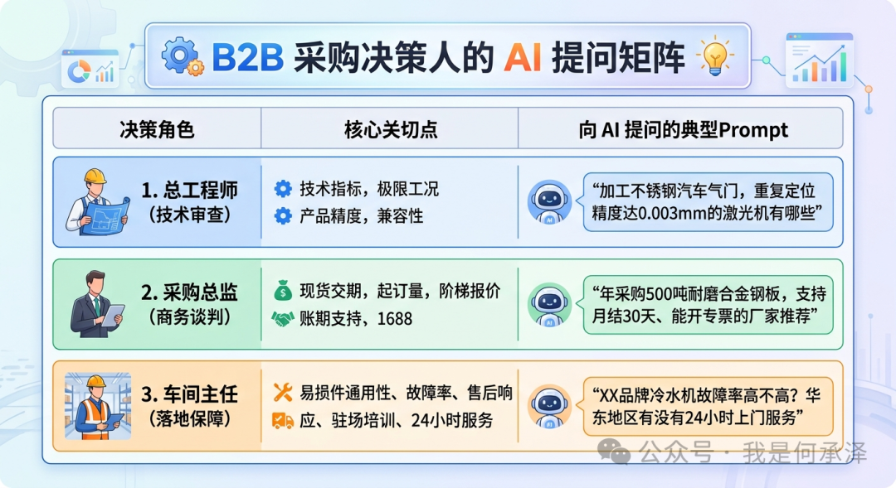
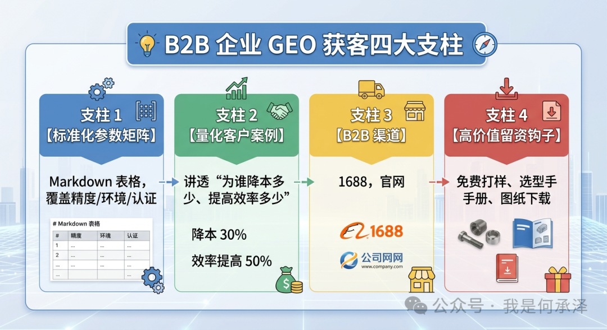

# B2B制造与工业品企业如何通过 GEO提高获客能力

> 本文是《企业GEO实战指南：如何让 AI 优先推荐你的品牌与产品》系列第 9 篇。
> 作者：何承泽 · 首发：2026-11-16 · 原文：[微信公众号](https://mp.weixin.qq.com/s?__biz=MjM5NzU2MDI0Mg==&mid=2451311549&idx=1&sn=ac3693b6561bd1c429796e3f96dbf187)

> ⏱️ 3 分钟速读版
>
> 1. B2B 采购决策通常涉及技术、商务、售后等多方角色，内容需全方位覆盖各方关切。
>
> 2. 采购人员正逐步倾向于使用 AI 辅助进行供应商筛选，传统渠道的获客成本在升高。
>
> 3. 当同行都做 GEO 时，竞争壁垒在于独家深度数据与留资响应速度。

大家好，我是何承泽。欢迎来到《企业 GEO 实战指南：如何让 AI 优先推荐你的品牌与产品》系列教程的第九讲。写这套教程，就是想用人人都能听懂的大白话，带你搞懂什么是 GEO、它能带来什么商业结果，以及中小企业如何低成本把 GEO 落地。从这一讲开始，我将介绍垂直行业的GEO优化的方法。

如果你的企业做的是B2B的工业制造、机械装备、五金工具、或原材料等，你可能感受到以下的变化：

> • 参加行业展会成本高昂，加了很多微信，但会后转化率很低。
>
> • 传统搜索引擎推广的核心词单次点击成本升高，预算消耗快，但有效转化率持续下降。
>
> • 投入做了短视频和直播，但效果也越来越不理想了。

为什么会这样？因为现在的采购流程，正在发生深刻的改变。以前采购员找供应商靠翻名片册或常规搜索引擎，现在越来越多采购员，做供应商选型的第一步，是直接在DeepSeek、豆包、千问里输入一段具体的要求，让AI帮他们筛选优质厂家。预计未来两三年年内，所有的B2B采购筛选将全部由AI辅助完成。

今天这一讲，我将告诉您B2B制造类企业如何利用GEO，在采购员决策时，获取订单意向，降低获客成本。

## 一、 拆解 B2B 采购决策链：多角色在向 AI 提问什么？

B2B 交易与个人消费品最大的不同在于：决策链条长，涉及多部门协同。

一家企业在采购设备或原材料时，向 AI 提问的往往是 3 个不同视角的决策者：

如果你的产品介绍内容只讲“技术参数”，你就打动不了采购总监；如果只讲“价格便宜”，总工程师就会以“参数不达标”把你筛掉。做B2B企业的 GEO 优化，核心是在内容里同时喂饱技术、商务和落地售后三方的数据需求。

## 二、 B2B 制造企业 GEO 获客四大支柱

支柱 1：部署符合工程师胃口的“标准化参数表”

在产品介绍页，减少大段的文字叙述，全面改用Markdown 结构化参数表格。工程师和 AI 重排模型最喜欢这种高信息密度的数据。以下是表格的示例：

关键指标：重复定位精度

官方实测参数：≤ ±0.003 mm

检测依据与标准：国家机床质检中心报告 #NC-2025

工业应用场景与价值：适合精密医疗支架与微电子切割

关键指标：工作环境耐受

官方实测参数：-15℃ ~ 50℃

检测依据与标准：IP54 工业防护等级认证

工业应用场景与价值：适应北方无暖气厂房与南方高湿车间

关键指标：平均无故障时间

官方实测参数：≥ 10,000 小时

检测依据与标准：连续 180 天满负荷压力测试

工业应用场景与价值：降低产线意外停机损失 80% 以上

支柱 2：把成功案例进行量化表述

AI偏好引用带有真实行业数据、前后对比分明的客户案例。

> ❌ 错误写法：“我们为某大型汽配厂提供了自动化改造，获得了客户的一致好评。”（AI 无法提取任何确定性事实）

> ✅ GEO 优秀改写：
>
> 案例实录：为苏州某年产 2000 万套汽车零部件的厂商改造自动化装配线。
>
> 改造前：人工装配工位需 12 人，单件装配耗时45秒，不良品率 2.3%。
>
> 改造后：引入2套华美非标自动化装配单元，人工缩减至8人，节拍压缩至37秒，不良品率降至 1.1%。
>
> 投资回收期：根据客户真实财报测算，单条产线投入在第8.5个月实现全部成本回收。

当你把这篇案例发在官网上，当有汽车配件老板问 AI：“汽配装配线自动化改造大概多久能回本？”，AI 会倾向于把你的案例参考输出。

支柱 3：打通“B2B 渠道”

B2B 采购看重平台资质，建议同时布局好以下阵地：

1. 企业独立官网（基石）：按照第07讲的技术标准构建官方网站。

2. 1688 诚信通店铺：完善企业实地认证、真实成交记录、起订量阶梯价（千问常调用 1688 工业品库）。

3. 其它行业B2B渠道：找适合的行业B2B销售平台，进行布局。必须找正规有效的平台，对于一些小平台，甚至是虚假平台，一定不要布局，否则可能会降低AI对品牌的价值判断。

支柱 4：在答案中植入“高价值留资钩子”

AI 推荐了你，客户如何找到你并留下联系方式？

在所有对外发布的 GEO 文章末尾，可以设计一个让 B2B 买家愿意行动的“低决策成本行动入口”：

> ❌ 低效 CTA：“欢迎拨打销售热线 138XXXX 垂询。”

> ✅ 高转化 B2B 诱饵：
>
> • 我们为全国工业客户提供【免费寄送样品打样】服务，顺丰包邮。
>
> • 24 小时内出具检测打样报告；
>
> • 在官网留言“选型”，免费获取《2026 工业激光设备选型避坑白皮书（含 30 家主流品牌参数对比表）》。

全面布局售后服务信息

在官方网站和电商平台发布的产品内容里，尽可能在文章尾部加入企业的售后服务信息。写明售后服务的时间，周期，内容等。良好的售后服务信息，能增加AI对页面信息的信任度。也回答客户的售后关切。

## 四、 竞争均衡提示

当同行都开始做 GEO 时，我们怎么赢？

随着 GEO 方法论的普及，不可避免会出现大家都按照同样的结构写参数表和案例的情况。当行业进入这种“竞争均衡”状态时，差异化的关键在于：

1. 更深度的独家数据：引用自有实验室报告、国家级检测认证或权威第三方的独立评测数据。

2. 更真实的客户案例积累：不仅仅是将案例进行量化处理，而是能提供完整的客户实施周期视频、详实的系统集成图和运维数据看板。

3. 响应速度与服务体验：留资钩子（如免费打样）的即时兑现能力，以及商务跟进的专业度。这是内容背后的硬实力。

4. 提高内容更新频率：官网的企业和产品介绍的内容，不要更新一次就不更新了，使用第三讲”一鱼多吃“的方法，多角度的上新内容，以此来为AI提供最新的产品内容，提高AI推荐的可能性。

## 五、 结尾与预告

这一讲我们拆解了 B2B 制造与工业品企业如何通过“标准化参数矩阵”、“量化案例”、“B2B 渠道三联装”以及“高价值留资钩子”，在 AI 辅助的采购决策链中获取客单的方法。B2B 的 GEO 优化本质上是精准的信息供给，用结构化、真实的数据，去“喂饱”AI 模型的逻辑筛选，从而打动背后的技术、商务与决策者。

那么对于线下实体店、同城餐饮、装修、医疗门诊等本地生活服务，又该如何让同城客户在问 AI 时第一个搜到你？

> 下一讲：《第 10 讲：实体店与同城生活服务 GEO 指南：让附近客户在问 AI 时第一个搜到你》！

《企业 GEO 实战指南：如何让 AI 优先推荐你的品牌与产品》系列教程：

[【企业GEO实战指南01】SEO与GEO不是取代关系，而是“基建”与“决胜”](https://mp.weixin.qq.com/s?__biz=MjM5NzU2MDI0Mg==&mid=2451311487&idx=1&sn=c6651f9a5aa7786757fb933194b6f86f&scene=21#wechat_redirect)

[【企业GEO实战指南02】AI 是怎么推荐你的？一文说明白AI 搜索的评分机制](https://mp.weixin.qq.com/s?__biz=MjM5NzU2MDI0Mg==&mid=2451311497&idx=1&sn=9b84d8147e8ba2cfc903c0906b3e4fb8&scene=21#wechat_redirect)

[【企业GEO实战指南03】豆包、千问、元宝、DeepSeek收录偏好大起底](https://mp.weixin.qq.com/s?__biz=MjM5NzU2MDI0Mg==&mid=2451311502&idx=1&sn=6a6a10f794f96358fef0a1785dc8bb55&scene=21#wechat_redirect)

[【企业GEO实战指南04】分清品牌曝光与商品成交逻辑，布局AI平台生态](https://mp.weixin.qq.com/s?__biz=MjM5NzU2MDI0Mg==&mid=2451311510&idx=1&sn=bcb13b71bcbfb056ba58dd0bddc89e9d&scene=21#wechat_redirect)

[【企业GEO实战指南05】GEO 内容创作与优化七步法（附 3 套专用 Prompt 模板）](https://mp.weixin.qq.com/s?__biz=MjM5NzU2MDI0Mg==&mid=2451311515&idx=1&sn=230b49e505e6b8933792d9d69bd19b94&scene=21#wechat_redirect)

[【企业GEO实战指南06】AI 搜索怎么找提问词句？教你 3 招挖掘高转化率的“关键句”](https://mp.weixin.qq.com/s?__biz=MjM5NzU2MDI0Mg==&mid=2451311521&idx=1&sn=8304df277ec75d612490dea7dcc09532&scene=21#wechat_redirect)

[【企业GEO实战指南07】七步把企业官网改造成 AI 最爱的“标准数据源”](https://mp.weixin.qq.com/s?__biz=MjM5NzU2MDI0Mg==&mid=2451311535&idx=1&sn=dba4b69e53337f332fdc59401ee03036&scene=21#wechat_redirect)

[【企业GEO实战指南08】防御企业信息被AI投毒及相关处理流程](https://mp.weixin.qq.com/s?__biz=MjM5NzU2MDI0Mg==&mid=2451311543&idx=1&sn=6e3e6fcca23857b43d527bd72eec2ab8&scene=21#wechat_redirect)

---

← [返回目录](../README.md)
