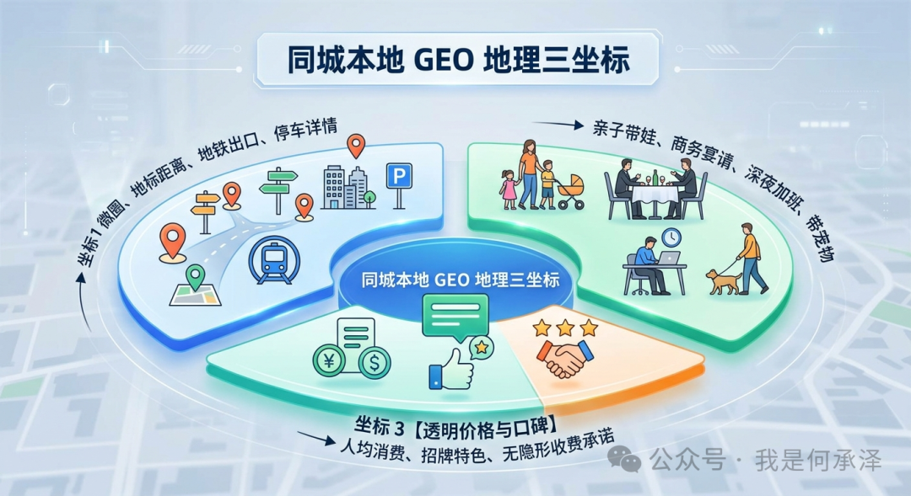
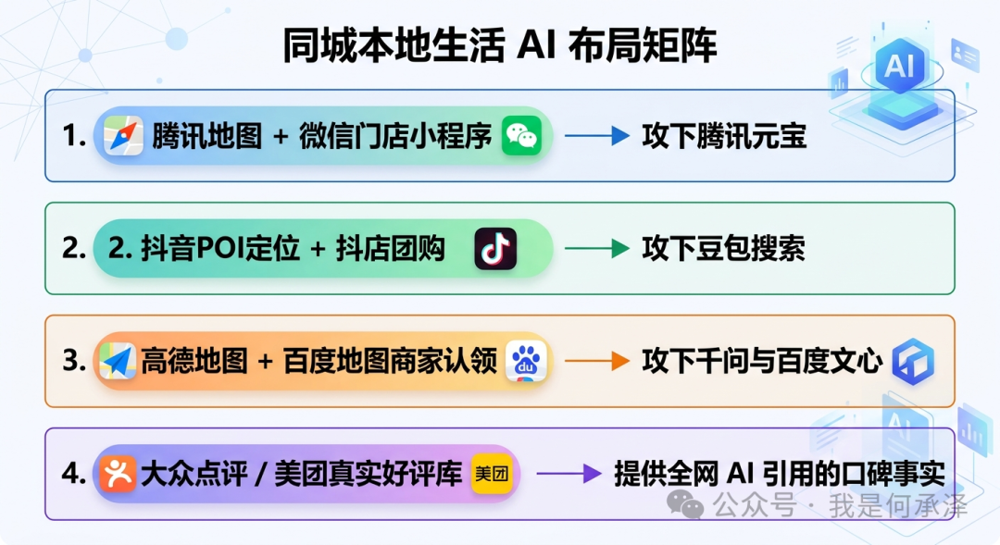

# 本地生活类实体店如何让顾客在问AI时推荐你

> 本文是《企业GEO实战指南：如何让 AI 优先推荐你的品牌与产品》系列第 10 篇。
> 作者：何承泽 · 首发：2026-11-17 · 原文：[微信公众号](https://mp.weixin.qq.com/s?__biz=MjM5NzU2MDI0Mg==&mid=2451311556&idx=1&sn=406c89da77322f8f77565d48d95e6175)

⏱️ 3 分钟速读版

1. 传统本地生活平台的流量红利逐渐减弱，AI 成为消费者寻找本地服务的新入口。

2. AI 检索同城门店依赖“地理三坐标模型”：微观空间、场景人群、透明价格。

3. 必须详细描述商圈、地铁距离及停车等微观空间信息，方便 AI 定位。

4. 根据亲子、商务、宠物等细分人群，在平台简介中标注对应的场景服务（如母婴室、包厢）。

5. 跨平台布局：腾讯地图、抖音 POI、高德/百度地图、大众点评等均不可忽视。

6. 引导顾客发布包含“具体场景痛点”的真实长评，提升在 AI 抓取时的权重。

7. 地图数据的审核与更新存在滞后周期，需提前规划与定期维护。

大家好，我是何承泽。欢迎来到《企业 GEO 实战指南：如何让 AI 优先推荐你的品牌与产品》系列教程的第十讲。写这套教程，就是想用人人都能听懂的大白话，带你搞懂什么是 GEO、它能带来什么商业结果，以及中小企业如何低成本把 GEO 落地。从这一讲开始，我将介绍垂直行业的GEO优化的方法。

如果你开的是 实体餐厅、医美口腔、亲子摄影、汽车养护、健身瑜伽 等同城生活服务门店，你可能正面临这样的困扰：

> 1.本地生活平台的商户推广费用增加，流量红利减弱；
>
> 2.常规的短评或雷同好评很难再打动消费者，消费者对信息的甄别能力越来越强；
>
> 3.本地到店客流的获客成本不断上升。

但在另一边，消费者的搜索信息习惯正在发生改变：

- 过去：在大众点评搜“粤菜”，在长长的商户列表里筛选比对；

- 现在：直接打开豆包或DeepSeek，输入一段包含具体约束的口语指令：

> “我们在后海公园附近，一家三口带一个四岁宝宝，想找一家环境安静、不油腻、有宝宝椅、人均 100 左右的粤菜餐厅，要有免费停车位，推荐两家最合适的。”

在极短的时间内，AI 会综合多方数据给出契合的餐厅推荐，并附带推荐理由：“【某某粤菜轩】距离朝阳公园南门500 米，餐厅配有专业母婴室与宝宝餐椅，招牌清蒸鲈鱼少油少盐，地下车库凭小票免费停 2 小时……”

如果你的门店信息足够丰富且被 AI 成功收录，你就能以较低的机会成本，直接获取这种高意向的精准到店客户！

今天这一讲，我将为你交付一套本地生活实体店的GEO 优化指南！

> ## 一、 本地生活GEO：“地理三坐标模型”

AI 在检索本地门店时，核心依赖以下 “地理三坐标” 的语义匹配。

> 经验观察：超过 80% 的本地化用户提问prompt都包含了这三个维度的至少一项。

坐标 1：微观空间与交通细节（AI 空间定位锚点）

很多实体店在网上写地址，只写“XX市XX区XX路18号”，这在 AI 眼里信息量较少。

> ❌ 低效写法
>
> “位于朝阳区亮马桥路。”

> ✅ GEO 空间优化
>
> “地处朝阳区亮马桥商圈，紧邻朝阳公园西门（步行 200 米）；乘坐地铁 10 号线亮马桥站 B 口出站直行 150 米即达；自驾车主可直达地下停车场，就餐提供免费停车券 2 小时。”

坐标 2：极致细分的人群与场景约束（精准分流）

AI 用户提问时，最常带有“特殊场景标签”。建议在各大地图和平台店面简介里明确标注这些信息：

- 亲子场景：“店内提供紫外线消毒宝宝椅、温奶器、儿童防摔餐具、独立母婴哺乳室；”

- 商务宴请：“拥有 6 间独立静音包厢，双层隔音玻璃，配有专业投影仪与隐私洽谈区；”

- 宠物友好：“室外拥有 200 平米独立草坪，免费提供宠物饮水碗与牵引绳挂钩。”

坐标 3：透明价格锚点与招牌服务

AI 更倾向于推荐价格透明、服务明晰的商家，避免推荐信息不透明的门店。

- 明确列出人均消费区间（如：“人均 120~160 元”）；

- 明确承诺：“明码标价、无隐形收费、提供正规发票”；

- 提炼 2~3 道招牌特色或服务亮点（如：“经国家级大厨研发的无添加老火靓汤”）。

> ## 二、 同城实体店各大 AI 平台布局

要想让同城客户在主流 AI 产品中搜到你，建议打通以下四大地图与内容数据源。

### 1. 腾讯地图与微信门店认证（主攻元宝）

在微信公众平台开通“微信门店小程序”，绑定腾讯地图精准坐标；元宝在推荐附近门店时，常优先调用微信生态内经过官方认证的商户。

### 2. 抖音认领 POI 门店定位（主攻豆包）

在抖音认领店铺 POI 锚点，完善营业时间、环境实拍与团购套餐；豆包在回答生活服务问题时，常直接挂载抖音 POI 卡片。

### 3. 高德与百度地图深度完善（主攻千问与文心）

认领高德和百度地图的商户后台，把营业时间、停车指引、招牌特色尽可能填全。

> 💡 特别提醒：平台商户信息审核与更新周期
>
> 在进行地图和平台数据完善时，请务必注意：
>
> • 审核滞后：高德、腾讯等地图平台的商户认领与资质变更，通常需要 1~3 个工作日的人工或机器审核。
>
> • AI 抓取延迟：即便地图上的信息已更新，大模型重新抓取和更新其知识库（RAG 索引）可能还需要 1~2 周的时间。
>
> • 建议操作：逢重大节假日或门店地址变更，务必提前半个月完成各类平台的信息更新，避免 AI 给出旧地址或错误的营业时间。

> ## 三、引导客户撰写“AI 友好型真实长评”

AI 在抓取大众点评、美团等平台的口碑时，更易提取包含具体场景的长评中的事实信息。简短的“好评”、“不错”权重相对较低。

把以下话术提供给一线服务人员参考（店员引导 AI 友好型评价话术）：

> “姐，今天带宝宝吃得还习惯吗？如果您觉得咱们家母婴室和宝宝餐挺好的，能不能顺手在大众点评/美团上帮我们写两句真实感受？麻烦您提一句【带娃很省心、停车很方便】，我们送您一份招牌甜品！”

引导出来的优质评价范例：

> 周末带 2 岁孩子来亮马桥这家店，服务很周到！服务员主动给热了辅食，母婴室很干净还有湿巾。车直接停地下挺方便，走的时候前台扫了 2 小时免费停车券，全家吃得很满意，适合带娃家庭！”

当全网沉淀了带有“亮马桥、2岁带娃、母婴室、免费停车”等关键词的真实长评时，AI 会更容易在匹配对应需求时推荐你的门店。

> ## 四、 结尾与预告

这一讲我们拆解了本地实体门店如何借助“地理三坐标模型”（微观交通、场景人群、透明价格）、多平台地图布局，以及引导“AI 友好型场景长评”，在 AI 搜索的本地消费决策中精准获取高意向到店客流。同城生活服务的 GEO 优化，本质上是用极具场景化、细节化且高度透明的服务事实，去“喂饱”大模型的空间与服务细节的信息匹配，让附近有明确诉求的客户在问 AI 时能够第一时间被引导至你的门店。

至此，我们已经完成了 B2B 工业制造与同城本地生活两大核心垂直行业的 GEO 实战拆解。

但在实际落地运营中，你可能会面临新的疑惑：

- 我们如何清晰知道自己的品牌和门店到底有没有被各大 AI 成功收录与推荐？

- 被 AI 推荐的排名突然下滑了该如何排查原因？

- 如何建立一套低成本、可持续的 GEO 效果监控与周报数据体系？

> 下一讲，我们将迎来全课的压轴大结局：
>
> 压轴第 11 讲：《第 11 讲：GEO 效果自检与周报体系：一套表格搞定全网 AI 曝光率与排名监测（附全套模板）》！

《企业 GEO 实战指南：如何让 AI 优先推荐你的品牌与产品》系列教程：

[【企业GEO实战指南01】SEO与GEO不是取代关系，而是“基建”与“决胜”](https://mp.weixin.qq.com/s?__biz=MjM5NzU2MDI0Mg==&mid=2451311487&idx=1&sn=c6651f9a5aa7786757fb933194b6f86f&scene=21#wechat_redirect)

[【企业GEO实战指南02】AI 是怎么推荐你的？一文说明白AI 搜索的评分机制](https://mp.weixin.qq.com/s?__biz=MjM5NzU2MDI0Mg==&mid=2451311497&idx=1&sn=9b84d8147e8ba2cfc903c0906b3e4fb8&scene=21#wechat_redirect)

[【企业GEO实战指南03】豆包、千问、元宝、DeepSeek收录偏好大起底](https://mp.weixin.qq.com/s?__biz=MjM5NzU2MDI0Mg==&mid=2451311502&idx=1&sn=6a6a10f794f96358fef0a1785dc8bb55&scene=21#wechat_redirect)

[【企业GEO实战指南04】分清品牌曝光与商品成交逻辑，布局AI平台生态](https://mp.weixin.qq.com/s?__biz=MjM5NzU2MDI0Mg==&mid=2451311510&idx=1&sn=bcb13b71bcbfb056ba58dd0bddc89e9d&scene=21#wechat_redirect)

[【企业GEO实战指南05】GEO 内容创作与优化七步法（附 3 套专用 Prompt 模板）](https://mp.weixin.qq.com/s?__biz=MjM5NzU2MDI0Mg==&mid=2451311515&idx=1&sn=230b49e505e6b8933792d9d69bd19b94&scene=21#wechat_redirect)

[【企业GEO实战指南06】AI 搜索怎么找提问词句？教你 3 招挖掘高转化率的“关键句”](https://mp.weixin.qq.com/s?__biz=MjM5NzU2MDI0Mg==&mid=2451311521&idx=1&sn=8304df277ec75d612490dea7dcc09532&scene=21#wechat_redirect)

[【企业GEO实战指南07】七步把企业官网改造成 AI 最爱的“标准数据源”](https://mp.weixin.qq.com/s?__biz=MjM5NzU2MDI0Mg==&mid=2451311535&idx=1&sn=dba4b69e53337f332fdc59401ee03036&scene=21#wechat_redirect)

[【企业GEO实战指南08】防御企业信息被AI投毒及相关处理流程](https://mp.weixin.qq.com/s?__biz=MjM5NzU2MDI0Mg==&mid=2451311543&idx=1&sn=6e3e6fcca23857b43d527bd72eec2ab8&scene=21#wechat_redirect)

[【企业GEO实战指南09】B2B制造与工业品企业如何通过 GEO提高获客能力](https://mp.weixin.qq.com/s?__biz=MjM5NzU2MDI0Mg==&mid=2451311549&idx=1&sn=ac3693b6561bd1c429796e3f96dbf187&scene=21#wechat_redirect)

---

← [返回目录](../README.md)
