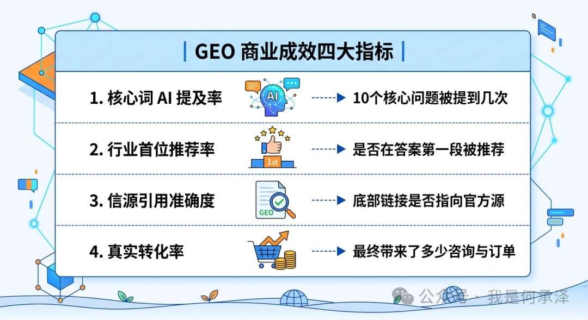
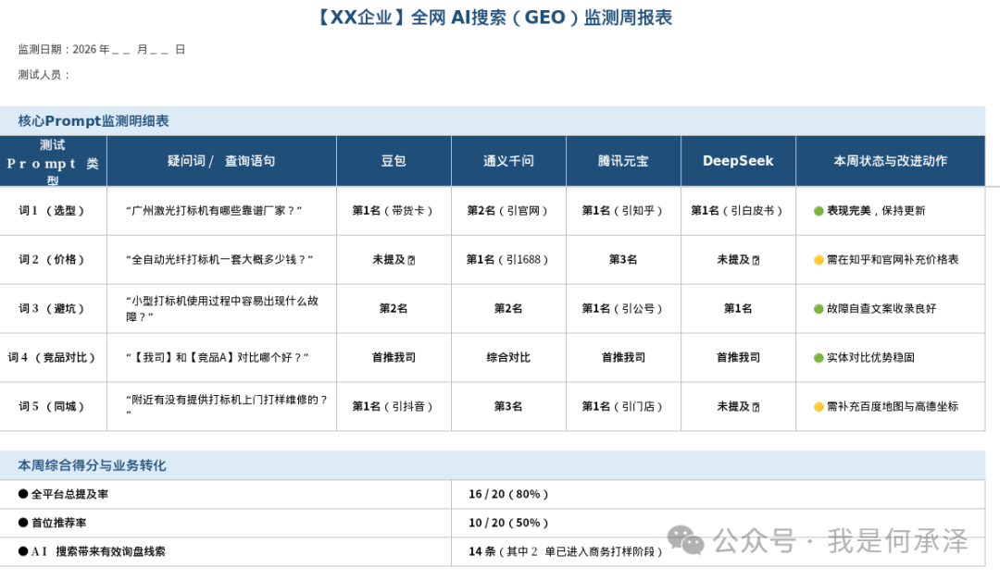
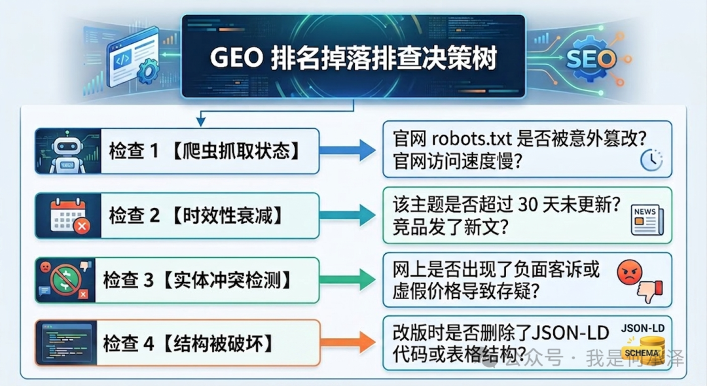

# GEO 效果自检与全网监测方法（附监测模板）

> 本文是《企业GEO实战指南：如何让 AI 优先推荐你的品牌与产品》系列第 11 篇。
> 作者：何承泽 · 首发：2026-11-18 · 原文：[微信公众号](https://mp.weixin.qq.com/s/3wzqZ_Zvr5RxJ557boUI1w)

⏱️ 3 分钟速读版

- GEO 不是一锤子买卖，必须建立基于“四大核心指标”的周期性监测机制。

- 四大黄金指标包括：核心词提及率、首位推荐率、信源准确度、真实线索转化率。

- 每周建议使用固定的 10 个测试词在四大主流 AI 中运行，并填写《全网 AI 搜索曝光周报表》。

- 若遇排名降权，可根据“4 步排查决策树”（通道、时效、信誉、结构）快速自诊修复。

- AI 环境变动快，必须建立版本管理和季度更新机制，保持策略的生命力。

大家好，我是何承泽。欢迎来到《企业 GEO 实战指南：如何让 AI 优先推荐你的品牌与产品》系列教程的第十一讲，也是实战课程的压轴大结语。写这套教程，就是想用人人都能听懂的大白话，带你搞懂什么是 GEO、它能带来什么商业结果，以及中小企业如何低成本把 GEO 落地。

经过前面十讲的学习，你已经了解了最底层的AI搜索的检索原理，通关了四大平台实测、七步文案方法、官网改造、防AI投毒与信息公关，以及两大垂直行业的GEO优化方法。

不过，在企业真实运营中，还有一环容易被跳过，就是GEO效果的监测与复盘。

内容也发了，官网也改了，怎么知道每天到底有多少潜在客户在 AI 搜索里看到了我们？如果曝光率掉了该怎么排查？如何建立一套长效的日常运营与周报机制？”

> 管理学中有一句被广泛引用的话：“无法衡量的事物，就无法被管理和增长。”

做 GEO 绝不是发完文章就听天由命，它和传统营销一样，必须建立一套日常自检、复盘与排查诊断体系。

在最后一讲，我将为你交付一套可以直接拿给运营团队执行的《GEO 监测与周报排查系统》，让你的整个 GEO 战略拥有圆满的闭环！

## 一、 衡量 GEO 成败的 4 大核心指标（KPI）

在 AI 搜索时代，衡量你的 GEO 是否真正产生商业价值，需要关注以下 4 个指标。

核心提Prompt及率：在你们行业设定的 10 个高频测试 Prompt 中，有多少个提问在生成的答案中明确出现了你的品牌名。

第一顺位首推率：AI 是把你列为“第一首选推荐”，还是放在最后当补充选项。

官方信源引用率：AI 答案底部附带的引用链接，是否直接指向你的官网、官方公众号/头条号等。

有效商业留资量：每周通过 AI 推荐引导至官网、微信或电商店铺的真实咨询量与成交额。

## 二、 【直接使用】企业级《全网 AI 搜索曝光周报表》

建议让你的市场或运营专员，在每周五下午固定时间，在四大主流 AI（DeepSeek、豆包、腾讯元宝、千问）中运行固定的 10 个测试词，并填写以下周报表。（可以私信获得表格文档）

## 三、 【排查决策树】为什么我的品牌突然被 AI 降权了？

做 GEO 过程中，如果某一天发现之前的排名掉了，或者某个词突然搜不出来了，对照以下 “4 步排查决策树” 进行自查：

> 第一步（查技术通道）：检查企业官网的服务器是否发生过 502 报错，robots.txt 或防火墙是否误拦截了网络爬虫，网站打开的速度是否变慢。

> 第二步（查时效性竞争）：大模型极度青睐“最新”数据。如果你的文章是半年前写的，而竞品在上周发布了包含最新参数的对比表，AI 会自动用竞品替换掉你；（解法：将以前的内容，结合最新的数据、场景等元素重新做一个新的文章发布，尤其是在竞争对手发布新的内容的时候）；

> 第三步（查信誉与负面）：检查是否有对手发了负面（参考第08讲 ），触发了 AI 的风险过滤机制；

> 第四步（查内容结构）：内容修正时，是否破坏了格式化的内容结构（参考第05讲）？如果是，立刻恢复。同时查看页面是否进行改版，破坏了JSON-LD代码。

## 四、 📋 版本管理与季度更新建议

在高速迭代的 AI 时代，一套固定的策略不可能永远生效。为了保证 GEO 策略的长效投资回报，建议企业遵守以下机制：

- 定期跑测与调整：建议每季度重新跑测所有核心 Prompt，根据业务重点更新周报模板中的平台覆盖范围与测试词库。

- 拥抱平台变化：AI 平台的爬虫策略、收录偏好、甚至是搜索结果呈现形式可能每个月都会发生变化。请保持对平台技术动态的关注。

- 建立内部知识库：建议建立团队内部的“GEO 知识库更新日志”，详细记录每次发现的平台变化、应对策略及效果数据，作为企业重要的数字资产。

## 五、 课程大结语：把你的企业资产，铸进大模型的神经元里

历时 11 讲，我们共同完成了这场跨越技术、算法、商业与实战的认知大迁徙。

回顾这整套课程：

> • 我们从第一讲的流量分流与规则演进启程；
>
> • 拆解了AI搜索地层机制与四大AI搜索平台信息源偏好；
>
> • 掌握了七步文案法与 3 大专用 Prompt；
>
> • 筑牢了企业官网的技术堡垒与防投毒公关防线；
>
> • 深入到了工业制造、同城实体垂直腹地；
>
> • 最终在这一讲完成了GEO优化的闭环。

作为一个在互联网行业看了20多年风云变幻的老兵，我想在最后送给大家一段肺腑之言：

回顾过去二十多年，流量的入口一直在变，企业的应对策略也必须随之而变。

在 PC 时代，我们研究 SEO 做搜索引擎排名；在移动互联网时代，我们购买平台流量、争夺平台红利。每一个时代的到来，都会带来一波全新的流量分配机制与红利期。

而今天，AI 搜索的兴起，正在开启属于 GEO 的新红利时代：它不是要推翻过去，而是搜索入口演变下的必然产物。只要我们保持对时代变迁的敏锐度，将产品与专业内容以适合大模型理解的形式进行结构化沉淀，就能在这个全新的流量入口里抢占先机。

商业的本质是顺势而为。紧跟技术与平台的变迁，拥抱每一个时代的流量新红利，你的企业才能在变局中持续赢得客户！

感谢你的认真研读与同行。

未来已来，时代正在犒赏那些第一批看清真相并付诸行动的务实者。

祝你的企业与品牌：在AI时代，长治久安，破浪前行！

我是何承泽

25+ 年互联网从业者|中老年 AI 实践者，正在用AI构建余生。

在这些地方可以找到我：

个人网站：www.kinggu.com

微信公众号：kingguw

如果企业在 GEO 实施、官网改造或大模型收录优化上有任何疑问，欢迎随时联系交流。

《企业 GEO 实战指南：如何让 AI 优先推荐你的品牌与产品》系列教程：

[【企业GEO实战指南01】SEO与GEO不是取代关系，而是“基建”与“决胜”](https://mp.weixin.qq.com/s?__biz=MjM5NzU2MDI0Mg==&mid=2451311487&idx=1&sn=c6651f9a5aa7786757fb933194b6f86f&scene=21#wechat_redirect)

[【企业GEO实战指南02】AI 是怎么推荐你的？一文说明白AI 搜索的评分机制](https://mp.weixin.qq.com/s?__biz=MjM5NzU2MDI0Mg==&mid=2451311497&idx=1&sn=9b84d8147e8ba2cfc903c0906b3e4fb8&scene=21#wechat_redirect)

[【企业GEO实战指南03】豆包、千问、元宝、DeepSeek收录偏好大起底](https://mp.weixin.qq.com/s?__biz=MjM5NzU2MDI0Mg==&mid=2451311502&idx=1&sn=6a6a10f794f96358fef0a1785dc8bb55&scene=21#wechat_redirect)

[【企业GEO实战指南04】分清品牌曝光与商品成交逻辑，布局AI平台生态](https://mp.weixin.qq.com/s?__biz=MjM5NzU2MDI0Mg==&mid=2451311510&idx=1&sn=bcb13b71bcbfb056ba58dd0bddc89e9d&scene=21#wechat_redirect)

[【企业GEO实战指南05】GEO 内容创作与优化七步法（附 3 套专用 Prompt 模板）](https://mp.weixin.qq.com/s?__biz=MjM5NzU2MDI0Mg==&mid=2451311515&idx=1&sn=230b49e505e6b8933792d9d69bd19b94&scene=21#wechat_redirect)

[【企业GEO实战指南06】AI 搜索怎么找提问词句？教你 3 招挖掘高转化率的“关键句”](https://mp.weixin.qq.com/s?__biz=MjM5NzU2MDI0Mg==&mid=2451311521&idx=1&sn=8304df277ec75d612490dea7dcc09532&scene=21#wechat_redirect)

[【企业GEO实战指南07】七步把企业官网改造成 AI 最爱的“标准数据源”](https://mp.weixin.qq.com/s?__biz=MjM5NzU2MDI0Mg==&mid=2451311535&idx=1&sn=dba4b69e53337f332fdc59401ee03036&scene=21#wechat_redirect)

[【企业GEO实战指南08】防御企业信息被AI投毒及相关处理流程](https://mp.weixin.qq.com/s?__biz=MjM5NzU2MDI0Mg==&mid=2451311543&idx=1&sn=6e3e6fcca23857b43d527bd72eec2ab8&scene=21#wechat_redirect)

[【企业GEO实战指南09】B2B制造与工业品企业如何通过 GEO提高获客能力](https://mp.weixin.qq.com/s?__biz=MjM5NzU2MDI0Mg==&mid=2451311549&idx=1&sn=ac3693b6561bd1c429796e3f96dbf187&scene=21#wechat_redirect)

[【企业GEO实战指南10】本地生活类实体店如何让顾客在问AI时推荐你](https://mp.weixin.qq.com/s?__biz=MjM5NzU2MDI0Mg==&mid=2451311556&idx=1&sn=406c89da77322f8f77565d48d95e6175&scene=21#wechat_redirect)

---

← [返回目录](../README.md)
